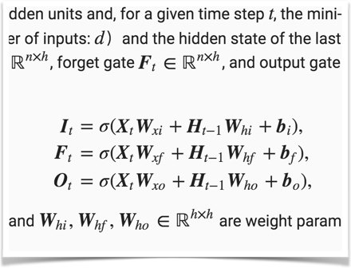
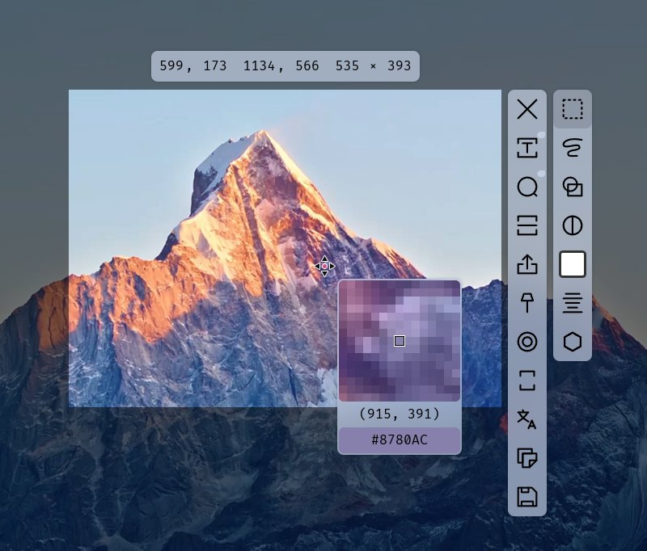
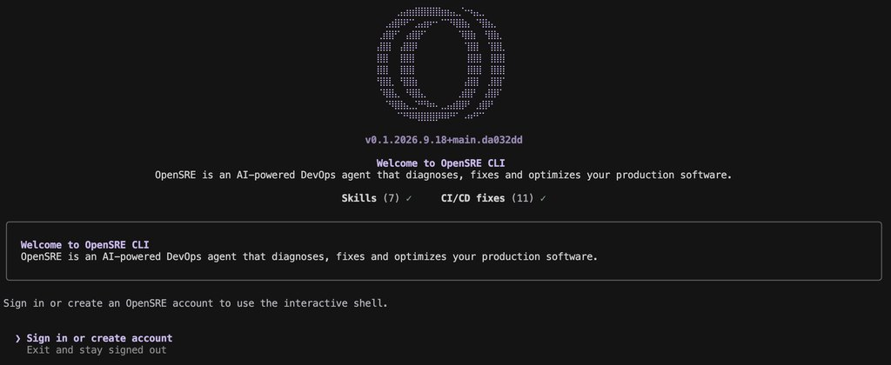

# GitHub Trending 日报 · 2026-11-22

> 2026 年 11 月 22 日 星期日 ｜ 采集时间 2026-11-22 12:43 GMT+8
> 数据来源：[中文榜](https://github.com/trending?since=daily&spoken_language_code=zh) · [全球榜](https://github.com/trending?since=daily)

共收录 **36** 个仓库（中文版 20，全球版 16），今日新增星标合计 **+10,847**。

## 今日 Top 5（按今日新增星标）

1. **[elementalsouls/Claude-BugHunter](https://github.com/elementalsouls/Claude-BugHunter)** — +1,803 · 给编码助手装上红队技能包
2. **[firecrawl/firecrawl](https://github.com/firecrawl/firecrawl)** — +1,006 · 一个 API 把网页喂给智能体
3. **[obra/superpowers](https://github.com/obra/superpowers)** — +883 · 让编码代理按方法论干活
4. **[XiaoYouChR/Ghost-Downloader-3](https://github.com/XiaoYouChR/Ghost-Downloader-3)** — +779 · 多协议通吃的桌面下载器
5. **[HKUDS/CLI-Anything](https://github.com/HKUDS/CLI-Anything)** — +769 · 把任何软件变成 Agent 可用的 CLI

---

## 一、中文版 · 20 个仓库

来源：<https://github.com/trending?since=daily&spoken_language_code=zh>

| # | 仓库 | 语言 | 星标 | 今日 | 一句话 |
| --- | --- | --- | ---: | ---: | --- |
| 1 | [aoaostar/legado](https://github.com/aoaostar/legado) | HTML | 7,609 | +33 | 阅读 App 书源合集 |
| 2 | [higress-group/higress](https://github.com/higress-group/higress) | Go | 9,807 | +6 | 能托管 MCP 的 AI 网关 |
| 3 | [ruanyf/weekly](https://github.com/ruanyf/weekly) | — | 108,504 | +57 | 每周五的科技与开源见闻 |
| 4 | [krahets/hello-algo](https://github.com/krahets/hello-algo) | Python | 132,540 | +39 | 动画图解的数据结构与算法 |
| 5 | [sngyai/Sequoia-X](https://github.com/sngyai/Sequoia-X) | Python | 8,789 | +16 | 收盘后自动选股的 A 股系统 |
| 6 | [521xueweihan/HelloGitHub](https://github.com/521xueweihan/HelloGitHub) | Python | 190,428 | +203 | 月刊式开源项目精选 |
| 7 | [wanglin2/mind-map](https://github.com/wanglin2/mind-map) | JavaScript | 13,021 | +7 | 可自部署的 Web 思维导图 |
| 8 | [d2l-ai/d2l-zh](https://github.com/d2l-ai/d2l-zh) | Python | 82,636 | +20 | 可运行的深度学习开源教材 |
| 9 | [XIU2/CloudflareSpeedTest](https://github.com/XIU2/CloudflareSpeedTest) | Go | 30,124 | +27 | 优选 Cloudflare 最快 IP |
| 10 | [fanmingming/live](https://github.com/fanmingming/live) | JavaScript | 28,929 | +17 | 电视广播台标与直播源工具 |
| 11 | [hiroi-sora/Umi-OCR](https://github.com/hiroi-sora/Umi-OCR) | Python | 48,863 | +27 | 离线批量 OCR，解压即用 |
| 12 | [zhayujie/CowAgent](https://github.com/zhayujie/CowAgent) | Python | 48,035 | +12 | 能长期记忆的个人 AI 助理 |
| 13 | [rebase-network/who-is-hiring](https://github.com/rebase-network/who-is-hiring) | HTML | 1,891 | +6 | 社区维护的招聘信息合集 |
| 14 | [jeecgboot/JeecgBoot](https://github.com/jeecgboot/JeecgBoot) | Java | 48,572 | +25 | 一句话生成业务系统的低代码平台 |
| 15 | [xushengfeng/eSearch](https://github.com/xushengfeng/eSearch) | TypeScript | 7,461 | +8 | 截图即搜索的效率工具 |
| 16 | [pymumu/smartdns](https://github.com/pymumu/smartdns) | C | 11,435 | +6 | 会测速的本地 DNS 服务器 |
| 17 | [jaywcjlove/linux-command](https://github.com/jaywcjlove/linux-command) | Markdown | 37,274 | +14 | 随用随查的 Linux 命令手册 |
| 18 | [JoeanAmier/TikTokDownloader](https://github.com/JoeanAmier/TikTokDownloader) | JavaScript | 17,615 | +18 | 抖音 / TikTok 批量采集 |
| 19 | [xifangczy/cat-catch](https://github.com/xifangczy/cat-catch) | JavaScript | 23,100 | +26 | 网页媒体资源嗅探扩展 |
| 20 | [xfangfang/wiliwili](https://github.com/xfangfang/wiliwili) | C++ | 5,733 | +7 | 跑在游戏机上的 B 站客户端 |

### 1. aoaostar / legado

> 阅读APP书源

**导读**：为「阅读」APP 维护的书源、订阅源、净化规则、排版与主题合集，每日自动同步数千条书源，并提供一键导入直链与网页版入口。

- 语言：HTML
- 星标：7,609（今日 +33）
- 标签：阅读 App 书源合集
- 仓库：<https://github.com/aoaostar/legado>

### 2. higress-group / higress

> 🤖 AI Gateway | AI Native API Gateway

**导读**：基于 Istio 与 Envoy 的云原生 API 网关，可用 Go / Rust / JS 编写 Wasm 插件扩展。除流量治理外，还支持托管 MCP Server、统一接入主流大模型，是 CNCF 沙箱项目。

- 语言：Go
- 星标：9,807（今日 +6）
- 标签：能托管 MCP 的 AI 网关
- 仓库：<https://github.com/higress-group/higress>

### 3. ruanyf / weekly

> 科技爱好者周刊，每周五发布

**导读**：阮一峰创办的科技爱好者周刊，每周五更新，记录一周内值得分享的科技动态、程序员职业观察与开源资源，另设《谁在招人》招聘帖，欢迎读者投稿。

- 语言：—
- 星标：108,504（今日 +57）
- 标签：每周五的科技与开源见闻
- 仓库：<https://github.com/ruanyf/weekly>

### 4. krahets / hello-algo

> 《Hello 算法》：动画图解、一键运行的数据结构与算法教程。支持简中、繁中、English、日本語，提供 Python, Java, C++, C, C#, JS, Go, Swift, Rust, Ruby, Kotlin, TS, Dart 等代码实现

**导读**：一本开源免费、新手友好的数据结构与算法入门书。全书用动画图解讲清概念，源代码可一键运行，已支持 Python、Java、C++、Go 等 12 门编程语言。

- 语言：Python
- 星标：132,540（今日 +39）
- 标签：动画图解的数据结构与算法
- 仓库：<https://github.com/krahets/hello-algo>

### 5. sngyai / Sequoia-X

> A股自动选股系统 — 多种技术形态自动扫描，收盘后自动运行并推送飞书

**导读**：面向 A 股的量化选股系统 V2。以向量化计算与增量数据更新为核心，内置海龟突破、均线放量、高窄旗形等六种形态策略，每日收盘后自动选股并推送飞书群。

- 语言：Python
- 星标：8,789（今日 +16）
- 标签：收盘后自动选股的 A 股系统
- 仓库：<https://github.com/sngyai/Sequoia-X>

### 6. 521xueweihan / HelloGitHub

> 分享 GitHub 上有趣、入门级的开源项目。Share interesting, entry-level open source projects on GitHub.

**导读**：兴趣是最好的老师。HelloGitHub 以月刊形式分享 GitHub 上有趣、入门级的开源项目、开源书籍与实战项目，让你用很短时间感受到开源的魅力。

- 语言：Python
- 星标：190,428（今日 +203）
- 标签：月刊式开源项目精选
- 仓库：<https://github.com/521xueweihan/HelloGitHub>

### 7. wanglin2 / mind-map

> SimpleMindMap（思绪思维导图）：一个强大的思维导图。A powerful mind map.

**导读**：中文名「思绪思维导图」。一个不依赖任何框架的 JavaScript 思维导图库，可快速开发 Web 脑图产品；同时提供支持本地文件、多主题与多格式导入导出的在线应用。

- 语言：JavaScript
- 星标：13,021（今日 +7）
- 标签：可自部署的 Web 思维导图
- 仓库：<https://github.com/wanglin2/mind-map>

### 8. d2l-ai / d2l-zh

> 《动手学深度学习》：面向中文读者、能运行、可讨论。中英文版被70多个国家的500多所大学用于教学。

**导读**：面向中文读者的深度学习开源教材，把概念、背景与可运行代码放在同一处讲解，兼顾数学原理与工程实现；全部内容可免费在线阅读，并被多所高校用作课程教材。

- 语言：Python
- 星标：82,636（今日 +20）
- 标签：可运行的深度学习开源教材
- 仓库：<https://github.com/d2l-ai/d2l-zh>

### 9. XIU2 / CloudflareSpeedTest

> 🌩「自选优选 IP」测试 Cloudflare CDN 延迟和速度，获取最快 IP ！当然也支持其他 CDN / 多个解析 IP 的网站 ~

**导读**：Cloudflare 公开了全部 IP 段，但其中对中国内地访客友好的并不多。这个工具批量测试延迟与速度，帮你从海量 IP 中筛出最快的那一个（IPv4 + IPv6）。

- 语言：Go
- 星标：30,124（今日 +27）
- 标签：优选 Cloudflare 最快 IP
- 仓库：<https://github.com/XIU2/CloudflareSpeedTest>

### 10. fanmingming / live

> ✯ 可直连访问的电视/广播图标库与相关工具项目 ✯ 🔕 永久免费 直连访问 完整开源 不断完善的台标 支持IPv4/IPv6双栈访问 🔕

**导读**：一个可直连访问的电视与广播图标库，永久免费、完整开源，配套提供 EPG 节目单接口、M3U 订阅示例与在线播放器等工具，支持 IPv4 / IPv6 双栈访问。

- 语言：JavaScript
- 星标：28,929（今日 +17）
- 标签：电视广播台标与直播源工具
- 仓库：<https://github.com/fanmingming/live>

### 11. hiroi-sora / Umi-OCR

> OCR software, free and offline. 开源、免费的离线OCR软件。支持截屏/批量导入图片，PDF文档识别，排除水印/页眉页脚，扫描/生成二维码。内置多国语言库。

**导读**：免费、开源、可批量的离线 OCR 软件，解压即用、无需联网。支持截图识别、批量图片、PDF 文档、二维码与公式识别，并提供命令行与 HTTP 接口方便二次集成。

- 语言：Python
- 星标：48,863（今日 +27）
- 标签：离线批量 OCR，解压即用
- 仓库：<https://github.com/hiroi-sora/Umi-OCR>

### 12. zhayujie / CowAgent

> Open-source personal AI assistant & Agent Harness. Plans tasks, runs tools and skills, self-evolves with memory and knowledge. Multi-agent, multi-model, multi-channel. Lightweight, extensible, one-line install.

**导读**：一个可自行部署的开源个人 AI 助理：主动规划任务、调用工具与 MCP，并通过长期记忆、知识库与自我演化逐渐了解你；支持多模型、多渠道与 7×24 常驻运行。

- 语言：Python
- 星标：48,035（今日 +12）
- 标签：能长期记忆的个人 AI 助理
- 仓库：<https://github.com/zhayujie/CowAgent>

### 13. rebase-network / who-is-hiring

> 这个仓库是由 Rebase 社区创建的，为区块链行业以及其他各行各业的企业和团队提供招聘信息披露机会，所有招聘信息都将在 Rebase 社区的所有媒体上进行发表。这都是免费的！

**导读**：Rebase 社区发起的招聘信息披露仓库，按公司与职位整理 Web3 及互联网团队的招聘信息，附内推联系方式，求职者可直接投递。

- 语言：HTML
- 星标：1,891（今日 +6）
- 标签：社区维护的招聘信息合集
- 仓库：<https://github.com/rebase-network/who-is-hiring>

### 14. jeecgboot / JeecgBoot

> 一款免费开源的 AI 低代码平台，也是 AI 时代构建复杂业务系统的开源基座！权限、多租户、工作流、报表、大屏、AI 知识库等通用能力开箱即用，AI 只需生成业务差异部分。AI Skills 一句话生成完整系统——建表、前后端代码、菜单权限、BPM 流程、表单、报表、大屏全自动。内置 AI 应用平台（聊天、知识库、流程编排、MCP），兼容主流大模型

**导读**：免费开源的 AI 低代码平台，内置权限、多租户、工作流、报表大屏与 AI 知识库；借助 AI Skills，一句话即可生成可运行、可维护、可二次开发的前后端业务系统。

- 语言：Java
- 星标：48,572（今日 +25）
- 标签：一句话生成业务系统的低代码平台
- 仓库：<https://github.com/jeecgboot/JeecgBoot>

### 15. xushengfeng / eSearch

> 截屏 离线OCR 搜索翻译 以图搜图 贴图 录屏 万向滚动截屏 屏幕翻译 Screenshot Offline OCR Search Translate Search for picture Paste the picture on the screen Screen recorder Omnidirectional scrolling screenshot Screen translator 支持Windows Linux macOS

**导读**：一款桌面截图与搜索工具：截图后可直接离线 OCR 取字、以图搜图、翻译、贴图、录屏与万向滚动截屏，把「截图之后要干什么」全部收进一个入口。

- 语言：TypeScript
- 星标：7,461（今日 +8）
- 标签：截图即搜索的效率工具
- 仓库：<https://github.com/xushengfeng/eSearch>

### 16. pymumu / smartdns

> A local DNS server to obtain the fastest website IP for the best Internet experience, support DoT, DoH, DoQ. 一个本地DNS服务器，获取最快的网站IP，获得最佳上网体验，支持DoH，DoT，DoQ。

**导读**：一个本地 DNS 服务器，通过并发查询与测速返回最快的网站 IP，支持 DNS over TLS / HTTPS、缓存、国内外分流与广告过滤，常被部署在路由器上。

- 语言：C
- 星标：11,435（今日 +6）
- 标签：会测速的本地 DNS 服务器
- 仓库：<https://github.com/pymumu/smartdns>

### 17. jaywcjlove / linux-command

> Linux命令大全搜索工具，内容包含Linux命令手册、详解、学习、搜集。https://git.io/linux

**导读**：Linux 命令大全搜索工具，收录数百个常用命令的语法、参数与实例，支持网页、命令行与浏览器插件等多种查询方式，随用随查。

- 语言：Markdown
- 星标：37,274（今日 +14）
- 标签：随用随查的 Linux 命令手册
- 仓库：<https://github.com/jaywcjlove/linux-command>

### 18. JoeanAmier / TikTokDownloader

> 抖音 / TikTok 平台作品下载/数据采集工具

**导读**：面向抖音与 TikTok 的作品下载与数据采集工具，支持账号、合集、直播、评论等批量抓取，可导出结构化数据，兼顾命令行与图形界面两种使用方式。

- 语言：JavaScript
- 星标：17,615（今日 +18）
- 标签：抖音 / TikTok 批量采集
- 仓库：<https://github.com/JoeanAmier/TikTokDownloader>

### 19. xifangczy / cat-catch

> 猫抓 浏览器资源嗅探扩展 / cat-catch Browser Resource Sniffing Extension

**导读**：一款浏览器资源嗅探扩展，能抓取网页中正在播放或加载的视频、音频、图片等媒体资源，支持 M3U8 解析与批量下载，安装即用。

- 语言：JavaScript
- 星标：23,100（今日 +26）
- 标签：网页媒体资源嗅探扩展
- 仓库：<https://github.com/xifangczy/cat-catch>

### 20. xfangfang / wiliwili

> 第三方B站客户端，目前可以运行在PC全平台、PSVita、PS4 、Xbox 和 Nintendo Switch上

**导读**：第三方 B 站客户端，基于 C++ 编写，可运行在 PC 全平台、PSVita、PS4、Xbox 与 Nintendo Switch 上，并为手柄操作做了专门适配。

- 语言：C++
- 星标：5,733（今日 +7）
- 标签：跑在游戏机上的 B 站客户端
- 仓库：<https://github.com/xfangfang/wiliwili>

---

## 二、全球版 · 16 个仓库

来源：<https://github.com/trending?since=daily>

| # | 仓库 | 语言 | 星标 | 今日 | 一句话 |
| --- | --- | --- | ---: | ---: | --- |
| 1 | [elementalsouls/Claude-BugHunter](https://github.com/elementalsouls/Claude-BugHunter) | Python | 16,290 | +1,803 | 给编码助手装上红队技能包 |
| 2 | [obra/superpowers](https://github.com/obra/superpowers) | Shell | 323,828 | +883 | 让编码代理按方法论干活 |
| 3 | [HKUDS/CLI-Anything](https://github.com/HKUDS/CLI-Anything) | Python | 62,171 | +769 | 把任何软件变成 Agent 可用的 CLI |
| 4 | [jingyaogong/minimind](https://github.com/jingyaogong/minimind) | Python | 68,223 | +488 | 两小时从零训出 64M 小模型 |
| 5 | [cursor/plugins](https://github.com/cursor/plugins) | TypeScript | 18,149 | +260 | Cursor 插件规范与官方插件 |
| 6 | [firecrawl/firecrawl](https://github.com/firecrawl/firecrawl) | TypeScript | 206,346 | +1,006 | 一个 API 把网页喂给智能体 |
| 7 | [nginx/nginx](https://github.com/nginx/nginx) | C | 32,760 | +189 | NGINX 官方源码仓库 |
| 8 | [openvinotoolkit/openvino](https://github.com/openvinotoolkit/openvino) | C++ | 11,961 | +200 | 跨硬件加速 AI 推理 |
| 9 | [cathrynlavery/diagram-design](https://github.com/cathrynlavery/diagram-design) | HTML | 69,873 | +583 | 45 种杂志级图表生成规范 |
| 10 | [mvanhorn/last30days-skill](https://github.com/mvanhorn/last30days-skill) | Python | 72,113 | +560 | 跨平台检索近 30 天讨论 |
| 11 | [google-labs-code/stitch-skills](https://github.com/google-labs-code/stitch-skills) | TypeScript | 11,523 | +326 | 跨代理通用的生成式 UI 技能库 |
| 12 | [mjmirza/app-store-compliance](https://github.com/mjmirza/app-store-compliance) | Shell | 3,493 | +720 | 上架前先过一遍的拒审清单 |
| 13 | [Tracer-Cloud/opensre](https://github.com/Tracer-Cloud/opensre) | Python | 14,051 | +450 | 自动排查 CI/CD 失败原因 |
| 14 | [toeverything/AFFiNE](https://github.com/toeverything/AFFiNE) | TypeScript | 76,374 | +574 | 文档 + 白板 + 数据库一体 |
| 15 | [XiaoYouChR/Ghost-Downloader-3](https://github.com/XiaoYouChR/Ghost-Downloader-3) | Python | 14,554 | +779 | 多协议通吃的桌面下载器 |
| 16 | [zhouxiaoka/autoclip](https://github.com/zhouxiaoka/autoclip) | Python | 12,955 | +683 | 长视频一键切成短视频 |

### 1. elementalsouls / Claude-BugHunter

> A Claude Code skill bundle for bug hunting and external red-team work - 82 skills, 15 slash commands, 681 disclosed-report patterns curated across 24 core vulnerability classes, plus enterprise identity + infrastructure attack matrices.

**导读**：面向漏洞挖掘与外部红队工作的 Claude Code 技能包：82 个技能、15 个斜杠命令，按 24 类核心漏洞整理了 681 个已披露报告的模式，并附带企业身份与基础设施攻击矩阵。

- 语言：Python
- 星标：16,290（今日 +1,803）
- 标签：给编码助手装上红队技能包
- 仓库：<https://github.com/elementalsouls/Claude-BugHunter>

### 2. obra / superpowers

> An agentic skills framework & software development methodology that works.

**导读**：一套给编码智能体用的开发方法论：从需求澄清、写设计与计划，到 TDD、子代理并行实现与代码评审，全部由可组合的技能自动触发，让代理按流程而非碰运气地写代码。

- 语言：Shell
- 星标：323,828（今日 +883）
- 标签：让编码代理按方法论干活
- 仓库：<https://github.com/obra/superpowers>

### 3. HKUDS / CLI-Anything

> "CLI-Anything: Making ALL Software Agent-Native" -- CLI-Hub: https://clianything.cc/

**导读**：香港大学团队的项目，目标是让所有软件都能被智能体直接调用：自动分析软件源码并生成带 JSON 输出的命令行接口，用真实后端取代脆弱的截图点击式 GUI 自动化。

- 语言：Python
- 星标：62,171（今日 +769）
- 标签：把任何软件变成 Agent 可用的 CLI
- 仓库：<https://github.com/HKUDS/CLI-Anything>

### 4. jingyaogong / minimind

> 🧠 两小时从 0 训出你的 64M 大模型。Train your own 64M LLM from scratch in 2 hours.

**导读**：用约 3 块钱成本、2 小时就能复现的 64M 超小语言模型。项目以原生 PyTorch 实现预训练、SFT、LoRA、RLHF 与 Agentic RL 全链路，让你亲手跑通大模型的每一行核心代码。

- 语言：Python
- 星标：68,223（今日 +488）
- 标签：两小时从零训出 64M 小模型
- 仓库：<https://github.com/jingyaogong/minimind>

### 5. cursor / plugins

> Cursor plugin specification and official plugins

**导读**：Cursor 官方开放的插件规范与首批官方插件仓库，定义插件如何声明能力、打包与分发，是第三方为 Cursor 扩展工具链的起点。

- 语言：TypeScript
- 星标：18,149（今日 +260）
- 标签：Cursor 插件规范与官方插件
- 仓库：<https://github.com/cursor/plugins>

### 6. firecrawl / firecrawl

> Knowledge infrastructure to make your agents smarter. Search, scrape and access 550+ data providers through one API.

**导读**：给智能体用的知识基础设施：一个 API 完成搜索、抓取与整站爬取，把网页转成干净的 Markdown 或结构化 JSON，并可调用 550 多个数据提供方。

- 语言：TypeScript
- 星标：206,346（今日 +1,006）
- 标签：一个 API 把网页喂给智能体
- 仓库：<https://github.com/firecrawl/firecrawl>

### 7. nginx / nginx

> The official NGINX Open Source repository.

**导读**：NGINX 官方开源仓库。这个以高并发、低内存占用著称的 Web 服务器与反向代理，如今把开发主线迁回 GitHub，issue 与 PR 都在这里公开流转。

- 语言：C
- 星标：32,760（今日 +189）
- 标签：NGINX 官方源码仓库
- 仓库：<https://github.com/nginx/nginx>

### 8. openvinotoolkit / openvino

> OpenVINO™ is an open source toolkit for optimizing and deploying AI inference

**导读**：Intel 主导的开源 AI 推理优化与部署工具包，可把训练好的模型转换并压缩到 CPU、集成 GPU、NPU 等多种硬件上运行，覆盖从边缘设备到服务器的部署场景。

- 语言：C++
- 星标：11,961（今日 +200）
- 标签：跨硬件加速 AI 推理
- 仓库：<https://github.com/openvinotoolkit/openvino>

### 9. cathrynlavery / diagram-design

> Editorial diagram design for Claude Code, Codex, GitHub Copilot, Cursor, Factory Droid, Qoder, and Pi. 45 diagram types. Self-contained HTML + SVG. No shadows. No Mermaid slop.

**导读**：一套「编辑级」图表设计规范与技能包，为主流编码助手提供 45 种图表类型，直接产出可独立打开的 HTML + SVG，刻意不用阴影、也不生成千篇一律的 Mermaid 图。

- 语言：HTML
- 星标：69,873（今日 +583）
- 标签：45 种杂志级图表生成规范
- 仓库：<https://github.com/cathrynlavery/diagram-design>

### 10. mvanhorn / last30days-skill

> AI agent skill that researches any topic across Reddit, X, YouTube, HN, Polymarket, and the web - then synthesizes a grounded summary

**导读**：一个研究型 Agent 技能：给定任意话题，自动在 Reddit、X、YouTube、Hacker News、Polymarket 与公开网页上检索近 30 天的讨论，再汇总成有出处的结论。

- 语言：Python
- 星标：72,113（今日 +560）
- 标签：跨平台检索近 30 天讨论
- 仓库：<https://github.com/mvanhorn/last30days-skill>

### 11. google-labs-code / stitch-skills

> A library of Agent Skills designed to work with the Stitch MCP server. Each skill follows the Agent Skills open standard, for compatibility with coding agents such as Antigravity, Gemini CLI, Claude Code, Cursor.

**导读**：配合 Stitch MCP Server 使用的 Agent Skills 库，每个技能都遵循 Agent Skills 开放标准，因此可在 Antigravity、Gemini CLI、Claude Code、Cursor 等编码代理间通用。

- 语言：TypeScript
- 星标：11,523（今日 +326）
- 标签：跨代理通用的生成式 UI 技能库
- 仓库：<https://github.com/google-labs-code/stitch-skills>

### 12. mjmirza / app-store-compliance

> Avoid common App Store and Google Play rejections. Open playbook and pre-submission guard with 124 documented rejection patterns and fixes, privacy manifest and Data safety checks, 111 tracked deadlines (EU AI Act, DSA, COPPA, age laws), and a skill for AI coding agents.

**导读**：一份避免 App Store 与 Google Play 审核被拒的开放手册：整理 117 种已记录的拒审模式与修法，附隐私清单、数据安全检查，以及 95 个监管截止日期跟踪。

- 语言：Shell
- 星标：3,493（今日 +720）
- 标签：上架前先过一遍的拒审清单
- 仓库：<https://github.com/mjmirza/app-store-compliance>

### 13. Tracer-Cloud / opensre

> The open-source agent for CI/CD reliability.

**导读**：面向 CI/CD 可靠性的开源智能体，接入流水线后自动分析失败构建的日志与上下文，判断问题出在代码、依赖还是基础设施，并给出修复建议。

- 语言：Python
- 星标：14,051（今日 +450）
- 标签：自动排查 CI/CD 失败原因
- 仓库：<https://github.com/Tracer-Cloud/opensre>

### 14. toeverything / AFFiNE

> There can be more than Notion and Miro. AFFiNE(pronounced [ə‘fain]) is a next-gen knowledge base that brings planning, sorting and creating all together. Privacy first, open-source, customizable and ready to use.

**导读**：把文档、白板与数据库融为一体的下一代知识库，本地优先、隐私优先、可自部署，被视为 Notion 与 Miro 之外的开源替代方案。

- 语言：TypeScript
- 星标：76,374（今日 +574）
- 标签：文档 + 白板 + 数据库一体
- 仓库：<https://github.com/toeverything/AFFiNE>

### 15. XiaoYouChR / Ghost-Downloader-3

> The only downloader you need. 下载器的集大成者。

**导读**：基于 Python 与 Qt 的新一代下载器，支持 HTTP、BitTorrent、m3u8 与 FTP，多线程分片下载配合智能限速与断点续传，界面清爽且跨平台。

- 语言：Python
- 星标：14,554（今日 +779）
- 标签：多协议通吃的桌面下载器
- 仓库：<https://github.com/XiaoYouChR/Ghost-Downloader-3>

### 16. zhouxiaoka / autoclip

> AutoClip｜一个链接，一键出片。开源 AI 视频剪辑桌面工具，将播客、访谈、课程等长视频自动剪成短视频，生成字幕、封面和发布文案，适配抖音、小红书、TikTok、Reels 与 YouTube Shorts。Open-source AI video clipping & content repurposing.

**导读**：一个链接、一键出片的开源 AI 剪辑工具：把播客、访谈、课程等长视频自动切成适配抖音、小红书、TikTok、Reels 的短视频，并生成字幕、封面与发布文案。

- 语言：Python
- 星标：12,955（今日 +683）
- 标签：长视频一键切成短视频
- 仓库：<https://github.com/zhouxiaoka/autoclip>

---

## 说明

- 榜单顺序与字段取自 GitHub Trending 每日榜（since=daily），星标数与「今日新增」为采集时刻页面展示值。
- 「简介」为仓库在 GitHub 上的原始描述；「导读」为基于 README 的整理与中文编译，非逐字翻译。
- 配图取自仓库 README，已等比缩放并转存为 jpg（最长边 ≤ 1024px、单张 < 1MB）；文中路径相对于项目根目录，版权归原作者所有。
- 网页版：打开 `index.html`，右上角切换「日报 / 周报」与日期。
- 本文档由 `tools/build-report.js` 于 2026/11/22 12:46:54 生成。
