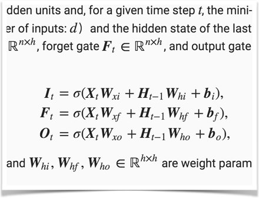
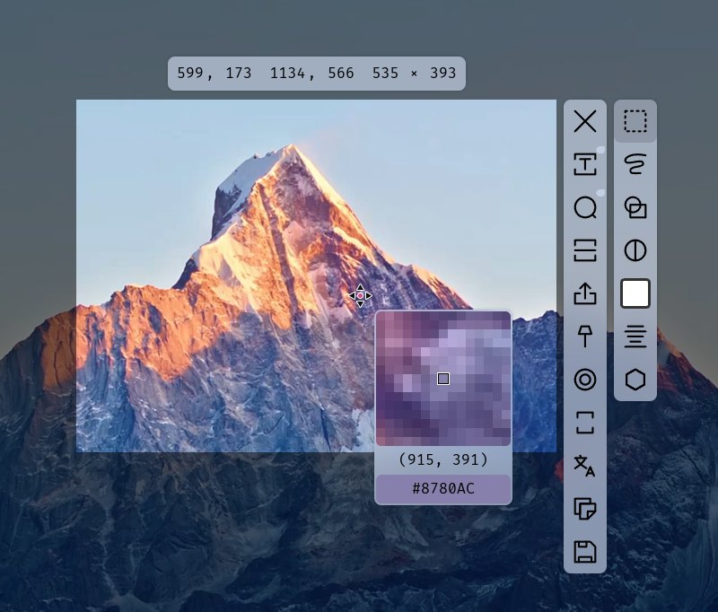
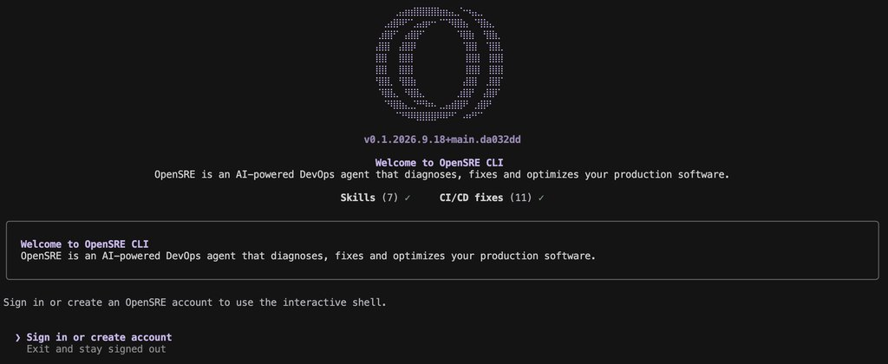
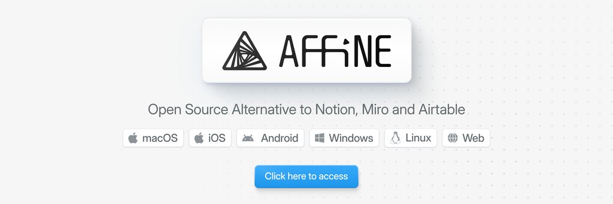

# GitHub Trending 日报 · 2026-11-23

> 2026 年 11 月 23 日 星期一 ｜ 采集时间 2026-11-23 12:30 GMT+8
> 数据来源：[中文榜](https://github.com/trending?since=daily&spoken_language_code=zh) · [全球榜](https://github.com/trending?since=daily)

共收录 **37** 个仓库（中文版 21，全球版 16），今日新增星标合计 **+10,404**。

## 今日 Top 5（按今日新增星标）

1. **[elementalsouls/Claude-BugHunter](https://github.com/elementalsouls/Claude-BugHunter)** — +1,716 · 把 Claude 变成挖洞研究员
2. **[firecrawl/firecrawl](https://github.com/firecrawl/firecrawl)** — +915 · 给 Agent 喂网页数据
3. **[obra/superpowers](https://github.com/obra/superpowers)** — +788 · 给编码 Agent 的开发方法论
4. **[XiaoYouChR/Ghost-Downloader-3](https://github.com/XiaoYouChR/Ghost-Downloader-3)** — +701 · 什么协议都能下
5. **[HKUDS/CLI-Anything](https://github.com/HKUDS/CLI-Anything)** — +699 · 让所有软件都能被 Agent 调用

---

## 一、中文版 · 21 个仓库

来源：<https://github.com/trending?since=daily&spoken_language_code=zh>

| # | 仓库 | 语言 | 星标 | 今日 | 一句话 |
| --- | --- | --- | ---: | ---: | --- |
| 1 | [aoaostar/legado](https://github.com/aoaostar/legado) | HTML | 7,661 | +55 | 「阅读」书源合集 |
| 2 | [higress-group/higress](https://github.com/higress-group/higress) | Go | 9,813 | +3 | 云原生 AI 网关 |
| 3 | [ruanyf/weekly](https://github.com/ruanyf/weekly) | — | 108,569 | +64 | 阮一峰的科技周刊 |
| 4 | [krahets/hello-algo](https://github.com/krahets/hello-algo) | Python | 132,597 | +56 | 动画图解数据结构 |
| 5 | [sngyai/Sequoia-X](https://github.com/sngyai/Sequoia-X) | Python | 8,805 | +19 | 收盘后自动选股推飞书 |
| 6 | [521xueweihan/HelloGitHub](https://github.com/521xueweihan/HelloGitHub) | Python | 190,626 | +189 | 每月推荐入门级开源项目 |
| 7 | [wanglin2/mind-map](https://github.com/wanglin2/mind-map) | JavaScript | 13,036 | +15 | 开源思维导图 |
| 8 | [1c7/chinese-independent-developer](https://github.com/1c7/chinese-independent-developer) | — | 62,271 | +10 | 独立开发者产品清单 |
| 9 | [d2l-ai/d2l-zh](https://github.com/d2l-ai/d2l-zh) | Python | 82,669 | +18 | 可运行的中文深度学习教材 |
| 10 | [XIU2/CloudflareSpeedTest](https://github.com/XIU2/CloudflareSpeedTest) | Go | 30,156 | +29 | 测出最快的 CF IP |
| 11 | [fanmingming/live](https://github.com/fanmingming/live) | JavaScript | 28,948 | +15 | 可直连的台标库 |
| 12 | [hiroi-sora/Umi-OCR](https://github.com/hiroi-sora/Umi-OCR) | Python | 48,872 | +18 | 免费离线截图识字 |
| 13 | [zhayujie/CowAgent](https://github.com/zhayujie/CowAgent) | Python | 48,044 | +19 | 会自己攒记忆的 Agent |
| 14 | [rebase-network/who-is-hiring](https://github.com/rebase-network/who-is-hiring) | HTML | 1,898 | +3 | 免费发布的招聘信息墙 |
| 15 | [jeecgboot/JeecgBoot](https://github.com/jeecgboot/JeecgBoot) | Java | 48,584 | +18 | 一句话生成整套系统 |
| 16 | [xushengfeng/eSearch](https://github.com/xushengfeng/eSearch) | TypeScript | 7,469 | +8 | 截图之后什么都能干 |
| 17 | [pymumu/smartdns](https://github.com/pymumu/smartdns) | C | 11,445 | +7 | 本地 DNS 挑最快 IP |
| 18 | [jaywcjlove/linux-command](https://github.com/jaywcjlove/linux-command) | Markdown | 37,287 | +15 | 600+ 命令速查手册 |
| 19 | [JoeanAmier/TikTokDownloader](https://github.com/JoeanAmier/TikTokDownloader) | JavaScript | 17,635 | +20 | 抖音作品下载与采集 |
| 20 | [xifangczy/cat-catch](https://github.com/xifangczy/cat-catch) | JavaScript | 23,129 | +26 | 浏览器资源嗅探 |
| 21 | [xfangfang/wiliwili](https://github.com/xfangfang/wiliwili) | C++ | 5,739 | +7 | 掌机上的 B 站客户端 |

### 1. aoaostar / legado

> 阅读APP书源

**导读**：为「阅读」App 维护的小说书源与订阅源集合，另附主题与排版配置。仓库本身不支持一键导入，需到配套站点 legado.aoaostar.com 逐条添加。

- 语言：HTML
- 星标：7,661（今日 +55）
- 标签：「阅读」书源合集
- 仓库：<https://github.com/aoaostar/legado>

### 2. higress-group / higress

> 🤖 AI Gateway | AI Native API Gateway

**导读**：基于 Istio 与 Envoy 的云原生 API 网关，可用 Go/Rust/JS 写 Wasm 插件扩展。内置数十个开箱即用插件与一套控制台，适合做 AI 流量的统一入口。

- 语言：Go
- 星标：9,813（今日 +3）
- 标签：云原生 AI 网关
- 仓库：<https://github.com/higress-group/higress>

### 3. ruanyf / weekly

> 科技爱好者周刊，每周五发布

**导读**：每周五更新的科技爱好者周刊，汇集当周值得一读的文章、工具与资源，投稿走 issue。星标十万加，是中文技术圈持续时间最长的个人周刊之一。

- 语言：—
- 星标：108,569（今日 +64）
- 标签：阮一峰的科技周刊
- 仓库：<https://github.com/ruanyf/weekly>

### 4. krahets / hello-algo

> 《Hello 算法》：动画图解、一键运行的数据结构与算法教程。支持简中、繁中、English、日本語，提供 Python, Java, C++, C, C#, JS, Go, Swift, Rust, Ruby, Kotlin, TS, Dart 等代码实现

**导读**：《Hello 算法》：用动画图解加可运行代码讲数据结构与算法，覆盖简中、繁中、英、日四种语言，附十余种编程语言实现，新手友好且完全免费。

- 语言：Python
- 星标：132,597（今日 +56）
- 标签：动画图解数据结构
- 仓库：<https://github.com/krahets/hello-algo>

### 5. sngyai / Sequoia-X

> A股自动选股系统 — 多种技术形态自动扫描，收盘后自动运行并推送飞书

**导读**：面向 A 股的量化选股系统，用向量化计算扫描多种技术形态，收盘后自动跑一遍并把结果推到飞书群。数据走 baostock，落本地 SQLite，绕开反爬。

- 语言：Python
- 星标：8,805（今日 +19）
- 标签：收盘后自动选股推飞书
- 仓库：<https://github.com/sngyai/Sequoia-X>

### 6. 521xueweihan / HelloGitHub

> 分享 GitHub 上有趣、入门级的开源项目。Share interesting, entry-level open source projects on GitHub.

**导读**：每月 28 号发布的开源月刊，挑有趣、入门级的项目与开源书籍、实战工程，帮新手用很短时间摸到开源的门。今日榜单里涨幅最猛的中文项目。

- 语言：Python
- 星标：190,626（今日 +189）
- 标签：每月推荐入门级开源项目
- 仓库：<https://github.com/521xueweihan/HelloGitHub>

### 7. wanglin2 / mind-map

> SimpleMindMap（思绪思维导图）：一个强大的思维导图。A powerful mind map.

**导读**：思维导图工具 SimpleMindMap：开源部分是 JavaScript 库，可嵌进自己的项目；配套桌面客户端为闭源软件。支持多种结构、主题与导出格式。

- 语言：JavaScript
- 星标：13,036（今日 +15）
- 标签：开源思维导图
- 仓库：<https://github.com/wanglin2/mind-map>

### 8. 1c7 / chinese-independent-developer

> 👩🏿‍💻👨🏾‍💻👩🏼‍💻👨🏽‍💻👩🏻‍💻中国独立开发者项目列表 -- 分享大家都在做什么

**导读**：一份中国独立开发者作品清单，收录打开即用的网站与 App，标注作者与状态。想看看别人业余在做什么、或想把自己的项目加进去，都从这里开始。

- 语言：—
- 星标：62,271（今日 +10）
- 标签：独立开发者产品清单
- 仓库：<https://github.com/1c7/chinese-independent-developer>

### 9. d2l-ai / d2l-zh

> 《动手学深度学习》：面向中文读者、能运行、可讨论。中英文版被70多个国家的500多所大学用于教学。

**导读**：《动手学深度学习》中文版：概念、背景、数学与代码在同一处讲清，中英文版被 70 多个国家 500 多所大学用于教学，全部 notebooks 可运行。

- 语言：Python
- 星标：82,669（今日 +18）
- 标签：可运行的中文深度学习教材
- 仓库：<https://github.com/d2l-ai/d2l-zh>

### 10. XIU2 / CloudflareSpeedTest

> 🌩「自选优选 IP」测试 Cloudflare CDN 延迟和速度，获取最快 IP ！当然也支持其他 CDN / 多个解析 IP 的网站 ~

**导读**：Cloudflare 分给内地访客的 IP 常常又慢又丢包。这个工具批量测延迟与速度，从公开 IP 段里挑出最适合自己的那个，也支持其他 CDN 与多解析站点。

- 语言：Go
- 星标：30,156（今日 +29）
- 标签：测出最快的 CF IP
- 仓库：<https://github.com/XIU2/CloudflareSpeedTest>

### 11. fanmingming / live

> ✯ 可直连访问的电视/广播图标库与相关工具项目 ✯ 🔕 永久免费 直连访问 完整开源 不断完善的台标 支持IPv4/IPv6双栈访问 🔕

**导读**：电视与广播的台标图标库及配套工具，支持 IPv4/IPv6 双栈直连访问。给自建直播源配图标时，能省掉到处找图、改尺寸这一步。

- 语言：JavaScript
- 星标：28,948（今日 +15）
- 标签：可直连的台标库
- 仓库：<https://github.com/fanmingming/live>

### 12. hiroi-sora / Umi-OCR

> OCR software, free and offline. 开源、免费的离线OCR软件。支持截屏/批量导入图片，PDF文档识别，排除水印/页眉页脚，扫描/生成二维码。内置多国语言库。

**导读**：开源免费的离线 OCR 软件：截屏识别、批量导图、PDF 识别都能做，可排除水印与页眉页脚，还能扫码与生成二维码，内置多国语言库。

- 语言：Python
- 星标：48,872（今日 +18）
- 标签：免费离线截图识字
- 仓库：<https://github.com/hiroi-sora/Umi-OCR>

### 13. zhayujie / CowAgent

> Open-source personal AI assistant & Agent Harness. Plans tasks, runs tools and skills, self-evolves with memory and knowledge. Multi-agent, multi-model, multi-channel. Lightweight, extensible, one-line install.

**导读**：开源的个人 AI 助手：主动拆解任务、调用工具与技能，通过长期记忆、知识库和自我进化慢慢熟悉你。支持多模型、多通道，一行命令安装。

- 语言：Python
- 星标：48,044（今日 +19）
- 标签：会自己攒记忆的 Agent
- 仓库：<https://github.com/zhayujie/CowAgent>

### 14. rebase-network / who-is-hiring

> 这个仓库是由 Rebase 社区创建的，为区块链行业以及其他各行各业的企业和团队提供招聘信息披露机会，所有招聘信息都将在 Rebase 社区的所有媒体上进行发表。这都是免费的！

**导读**：Rebase 社区维护的招聘信息仓库，区块链及其他行业团队都可免费发 JD，提 issue 后信息会自动同步到社区各渠道，长期免费。

- 语言：HTML
- 星标：1,898（今日 +3）
- 标签：免费发布的招聘信息墙
- 仓库：<https://github.com/rebase-network/who-is-hiring>

### 15. jeecgboot / JeecgBoot

> 一款免费开源的 AI 低代码平台，也是 AI 时代构建复杂业务系统的开源基座！权限、多租户、工作流、报表、大屏、AI 知识库等通用能力开箱即用，AI 只需生成业务差异部分。AI Skills 一句话生成完整系统——建表、前后端代码、菜单权限、BPM 流程、表单、报表、大屏全自动。内置 AI 应用平台（聊天、知识库、流程编排、MCP），兼容主流大模型

**导读**：免费开源的 AI 低代码平台，权限、多租户、工作流、报表、大屏、知识库开箱即用。AI Skills 能用一句话生成建表 SQL、前后端代码与菜单权限。

- 语言：Java
- 星标：48,584（今日 +18）
- 标签：一句话生成整套系统
- 仓库：<https://github.com/jeecgboot/JeecgBoot>

### 16. xushengfeng / eSearch

> 截屏 离线OCR 搜索翻译 以图搜图 贴图 录屏 万向滚动截屏 屏幕翻译 Screenshot Offline OCR Search Translate Search for picture Paste the picture on the screen Screen recorder Omnidirectional scrolling screenshot Screen translator 支持Windows Linux macOS

**导读**：把截屏、离线 OCR、搜索翻译、以图搜图、贴图、录屏、万向滚动截屏与屏幕翻译塞进一个桌面工具，Windows、Linux、macOS 都支持。

- 语言：TypeScript
- 星标：7,469（今日 +8）
- 标签：截图之后什么都能干
- 仓库：<https://github.com/xushengfeng/eSearch>

### 17. pymumu / smartdns

> A local DNS server to obtain the fastest website IP for the best Internet experience, support DoT, DoH, DoQ. 一个本地DNS服务器，获取最快的网站IP，获得最佳上网体验，支持DoH，DoT，DoQ。

**导读**：一个本地 DNS 服务器，为每个域名挑出响应最快的 IP 以改善上网体验。支持 DoT、DoH、DoQ 加密查询，带缓存加速与分流域名规则。

- 语言：C
- 星标：11,445（今日 +7）
- 标签：本地 DNS 挑最快 IP
- 仓库：<https://github.com/pymumu/smartdns>

### 18. jaywcjlove / linux-command

> Linux命令大全搜索工具，内容包含Linux命令手册、详解、学习、搜集。https://git.io/linux

**导读**：收录 600 多个 Linux 命令的手册与详解，配套一个没有任何广告的搜索网站，内容来自网络与网友补充，适合当日常速查表随手翻。

- 语言：Markdown
- 星标：37,287（今日 +15）
- 标签：600+ 命令速查手册
- 仓库：<https://github.com/jaywcjlove/linux-command>

### 19. JoeanAmier / TikTokDownloader

> 抖音 / TikTok 平台作品下载/数据采集工具

**导读**：抖音与 TikTok 的作品下载、数据采集工具，可批量抓账号作品与评论。Cookie 获取有专门教程，也能 Fork 后用 GitHub Actions 自动构建打包。

- 语言：JavaScript
- 星标：17,635（今日 +20）
- 标签：抖音作品下载与采集
- 仓库：<https://github.com/JoeanAmier/TikTokDownloader>

### 20. xifangczy / cat-catch

> 猫抓 浏览器资源嗅探扩展 / cat-catch Browser Resource Sniffing Extension

**导读**：「猫抓」浏览器扩展：把当前页面加载过的媒体资源筛出来列给你，视频、音频、图片一目了然，需要时直接下载，装了就能用。

- 语言：JavaScript
- 星标：23,129（今日 +26）
- 标签：浏览器资源嗅探
- 仓库：<https://github.com/xifangczy/cat-catch>

### 21. xfangfang / wiliwili

> 第三方B站客户端，目前可以运行在PC全平台、PSVita、PS4 、Xbox 和 Nintendo Switch上

**导读**：第三方 B 站客户端，覆盖 PC 全平台、PSVita、PS4、Xbox 与 Switch。触屏、鼠标、键盘、手柄都能操作，支持弹幕、直播、番剧与深浅主题。

- 语言：C++
- 星标：5,739（今日 +7）
- 标签：掌机上的 B 站客户端
- 仓库：<https://github.com/xfangfang/wiliwili>

---

## 二、全球版 · 16 个仓库

来源：<https://github.com/trending?since=daily>

| # | 仓库 | 语言 | 星标 | 今日 | 一句话 |
| --- | --- | --- | ---: | ---: | --- |
| 1 | [elementalsouls/Claude-BugHunter](https://github.com/elementalsouls/Claude-BugHunter) | Python | 18,143 | +1,716 | 把 Claude 变成挖洞研究员 |
| 2 | [obra/superpowers](https://github.com/obra/superpowers) | Shell | 324,289 | +788 | 给编码 Agent 的开发方法论 |
| 3 | [HKUDS/CLI-Anything](https://github.com/HKUDS/CLI-Anything) | Python | 62,913 | +699 | 让所有软件都能被 Agent 调用 |
| 4 | [jingyaogong/minimind](https://github.com/jingyaogong/minimind) | Python | 68,862 | +473 | 两小时训出 64M 小模型 |
| 5 | [cursor/plugins](https://github.com/cursor/plugins) | TypeScript | 18,517 | +294 | Cursor 官方插件集 |
| 6 | [firecrawl/firecrawl](https://github.com/firecrawl/firecrawl) | TypeScript | 207,166 | +915 | 给 Agent 喂网页数据 |
| 7 | [nginx/nginx](https://github.com/nginx/nginx) | C | 32,914 | +163 | NGINX 官方源码库 |
| 8 | [openvinotoolkit/openvino](https://github.com/openvinotoolkit/openvino) | C++ | 12,124 | +158 | 优化并部署推理 |
| 9 | [cathrynlavery/diagram-design](https://github.com/cathrynlavery/diagram-design) | HTML | 70,422 | +518 | 不套模板的图表设计 |
| 10 | [mvanhorn/last30days-skill](https://github.com/mvanhorn/last30days-skill) | Python | 72,873 | +668 | 按点赞数排序的搜索引擎 |
| 11 | [google-labs-code/stitch-skills](https://github.com/google-labs-code/stitch-skills) | TypeScript | 11,984 | +494 | Stitch 的设计技能库 |
| 12 | [mjmirza/app-store-compliance](https://github.com/mjmirza/app-store-compliance) | Shell | 4,125 | +621 | 上架前先自查一遍 |
| 13 | [Tracer-Cloud/opensre](https://github.com/Tracer-Cloud/opensre) | Python | 14,482 | +399 | CI/CD 可靠性 Agent |
| 14 | [toeverything/AFFiNE](https://github.com/toeverything/AFFiNE) | TypeScript | 76,920 | +542 | 文档白板二合一 |
| 15 | [XiaoYouChR/Ghost-Downloader-3](https://github.com/XiaoYouChR/Ghost-Downloader-3) | Python | 15,402 | +701 | 什么协议都能下 |
| 16 | [zhouxiaoka/autoclip](https://github.com/zhouxiaoka/autoclip) | Python | 13,652 | +641 | 一个链接一键出片 |

### 1. elementalsouls / Claude-BugHunter

> A Claude Code skill bundle for bug hunting and external red-team work - 82 skills, 15 slash commands, 681 disclosed-report patterns curated across 24 core vulnerability classes, plus enterprise identity + infrastructure attack matrices.

**导读**：给 Claude Code 装的一套技能包：82 个技能、15 个斜杠命令、681 条已披露报告的模式，覆盖 24 类漏洞与企业身份、基础设施攻击矩阵。今日涨了 1700 多星。

- 语言：Python
- 星标：18,143（今日 +1,716）
- 标签：把 Claude 变成挖洞研究员
- 仓库：<https://github.com/elementalsouls/Claude-BugHunter>

### 2. obra / superpowers

> An agentic skills framework & software development methodology that works.

**导读**：一套建立在可组合技能之上的软件开发方法论：Agent 一开工不会直接写代码，先退回来问清楚你到底要做什么，再按流程一步步推进。

- 语言：Shell
- 星标：324,289（今日 +788）
- 标签：给编码 Agent 的开发方法论
- 仓库：<https://github.com/obra/superpowers>

### 3. HKUDS / CLI-Anything

> "CLI-Anything: Making ALL Software Agent-Native" -- CLI-Hub: https://clianything.cc/

**导读**：港大的项目，目标是把各种软件的 CLI 封装成 AI Agent 可直接调用的接口。配套 CLI-Hub 可浏览、安装社区写好的 CLI，一条 pip 命令接入。

- 语言：Python
- 星标：62,913（今日 +699）
- 标签：让所有软件都能被 Agent 调用
- 仓库：<https://github.com/HKUDS/CLI-Anything>

### 4. jingyaogong / minimind

> 🧠 两小时从 0 训出你的 64M 大模型。Train your own 64M LLM from scratch in 2 hours.

**导读**：从零训练一个 64M 参数的小语言模型，全流程两小时跑完，代码与数据全部开放。想把大模型的预训练、微调、推理每个环节亲手过一遍，从这里开始。

- 语言：Python
- 星标：68,862（今日 +473）
- 标签：两小时训出 64M 小模型
- 仓库：<https://github.com/jingyaogong/minimind>

### 5. cursor / plugins

> Cursor plugin specification and official plugins

**导读**：Cursor 的插件规范与官方插件仓库，每个插件是根目录下一个独立文件夹，自带 manifest，覆盖主流开发工具、框架与 SaaS 产品。

- 语言：TypeScript
- 星标：18,517（今日 +294）
- 标签：Cursor 官方插件集
- 仓库：<https://github.com/cursor/plugins>

### 6. firecrawl / firecrawl

> Knowledge infrastructure to make your agents smarter. Search, scrape and access 550+ data providers through one API.

**导读**：面向 Agent 的知识基础设施：搜索、抓取并接入 550 多个数据源，统一成一套 API。仓库包含本地版、自托管服务端与各语言 SDK。

- 语言：TypeScript
- 星标：207,166（今日 +915）
- 标签：给 Agent 喂网页数据
- 仓库：<https://github.com/firecrawl/firecrawl>

### 7. nginx / nginx

> The official NGINX Open Source repository.

**导读**：NGINX 官方开源仓库。这个把 Web 服务器、负载均衡、反向代理、API 网关与内容缓存做在一起的老牌软件，至今仍是最主流的入口层选择。

- 语言：C
- 星标：32,914（今日 +163）
- 标签：NGINX 官方源码库
- 仓库：<https://github.com/nginx/nginx>

### 8. openvinotoolkit / openvino

> OpenVINO™ is an open source toolkit for optimizing and deploying AI inference

**导读**：Intel 主导的开源工具包，用于优化和部署深度学习推理：把训练好的模型转换后跑在 CPU、集成显卡与各类加速器上，附速查表与特性清单。

- 语言：C++
- 星标：12,124（今日 +158）
- 标签：优化并部署推理
- 仓库：<https://github.com/openvinotoolkit/openvino>

### 9. cathrynlavery / diagram-design

> Editorial diagram design for Claude Code, Codex, GitHub Copilot, Cursor, Factory Droid, Qoder, and Pi. 45 diagram types. Self-contained HTML + SVG. No shadows. No Mermaid slop.

**导读**：给编码 Agent 用的图表技能：输出单个自包含的 HTML + SVG 文件，52 种图型，按你的品牌配色。作者态度明确——不要阴影，也不要 Mermaid 那种千篇一律。

- 语言：HTML
- 星标：70,422（今日 +518）
- 标签：不套模板的图表设计
- 仓库：<https://github.com/cathrynlavery/diagram-design>

### 10. mvanhorn / last30days-skill

> AI agent skill that researches any topic across Reddit, X, YouTube, HN, Polymarket, and the web - then synthesizes a grounded summary

**导读**：一个 Agent 技能：跨 Reddit、X、YouTube、HN、Polymarket 与全网检索近 30 天的内容，再按点赞、喜欢与真金白银下注的金额排序，写成有依据的综述。

- 语言：Python
- 星标：72,873（今日 +668）
- 标签：按点赞数排序的搜索引擎
- 仓库：<https://github.com/mvanhorn/last30days-skill>

### 11. google-labs-code / stitch-skills

> A library of Agent Skills designed to work with the Stitch MCP server. Each skill follows the Agent Skills open standard, for compatibility with coding agents such as Antigravity, Gemini CLI, Claude Code, Cursor.

**导读**：Google Stitch 的 Agent 技能与插件集合，遵循 Agent Skills 开放标准，可在 Codex、Antigravity、Gemini CLI、Claude Code、Cursor 等编码 Agent 里直接用。

- 语言：TypeScript
- 星标：11,984（今日 +494）
- 标签：Stitch 的设计技能库
- 仓库：<https://github.com/google-labs-code/stitch-skills>

### 12. mjmirza / app-store-compliance

> Avoid common App Store and Google Play rejections. Open playbook and pre-submission guard with 124 documented rejection patterns and fixes, privacy manifest and Data safety checks, 112 tracked deadlines (EU AI Act, DSA, COPPA, age laws), and a skill for AI coding agents.

**导读**：App Store 与 Google Play 的过审手册：124 条被拒模式与对应改法、隐私清单与数据安全自查、112 个合规截止日，另附给 Agent 用的技能。

- 语言：Shell
- 星标：4,125（今日 +621）
- 标签：上架前先自查一遍
- 仓库：<https://github.com/mjmirza/app-store-compliance>

### 13. Tracer-Cloud / opensre

> The open-source agent for CI/CD reliability.

**导读**：开源的 CI/CD 可靠性 Agent：流水线出问题时介入排查，把失败日志、变更与依赖串起来定位原因，减少人工翻日志的时间。

- 语言：Python
- 星标：14,482（今日 +399）
- 标签：CI/CD 可靠性 Agent
- 仓库：<https://github.com/Tracer-Cloud/opensre>

### 14. toeverything / AFFiNE

> There can be more than Notion and Miro. AFFiNE(pronounced [ə‘fain]) is a next-gen knowledge base that brings planning, sorting and creating all together. Privacy first, open-source, customizable and ready to use.

**导读**：把文档、白板与数据库融进一个页面的知识库，本地优先、开源可自托管，定位是 Notion 与 Miro 之外的第三种选择。

- 语言：TypeScript
- 星标：76,920（今日 +542）
- 标签：文档白板二合一
- 仓库：<https://github.com/toeverything/AFFiNE>

### 15. XiaoYouChR / Ghost-Downloader-3

> The only downloader you need. 下载器的集大成者。

**导读**：一个几乎覆盖所有下载协议的下载器，支持 Windows、macOS、Linux 与 Android，带 Feature Packs 插件生态。最初只是给 B 站 UP 主整理素材的小工具。

- 语言：Python
- 星标：15,402（今日 +701）
- 标签：什么协议都能下
- 仓库：<https://github.com/XiaoYouChR/Ghost-Downloader-3>

### 16. zhouxiaoka / autoclip

> AutoClip｜一个链接，一键出片。开源 AI 视频剪辑桌面工具，将播客、访谈、课程等长视频自动剪成短视频，生成字幕、封面和发布文案，适配抖音、小红书、TikTok、Reels 与 YouTube Shorts。Open-source AI video clipping & content repurposing.

**导读**：开源 AI 视频剪辑桌面工具：贴一个链接、选好平台，长视频自动切成短视频并生成字幕、封面与发布文案，适配抖音、小红书、TikTok、Reels 与 Shorts。

- 语言：Python
- 星标：13,652（今日 +641）
- 标签：一个链接一键出片
- 仓库：<https://github.com/zhouxiaoka/autoclip>

---

## 说明

- 榜单顺序与字段取自 GitHub Trending 每日榜（since=daily），星标数与「今日新增」为采集时刻页面展示值。
- 「简介」为仓库在 GitHub 上的原始描述；「导读」为基于 README 的整理与中文编译，非逐字翻译。
- 配图取自仓库 README，已等比缩放并转存为 jpg（最长边 ≤ 1024px、单张 < 1MB）；文中路径相对于项目根目录，版权归原作者所有。
- 网页版：打开 `index.html`，右上角切换「日报 / 周报」与日期。
- 本文档由 `tools/build-report.js` 于 2026/11/23 12:48:20 生成。
