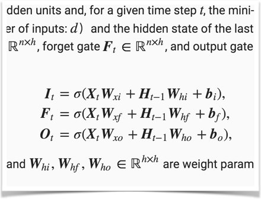
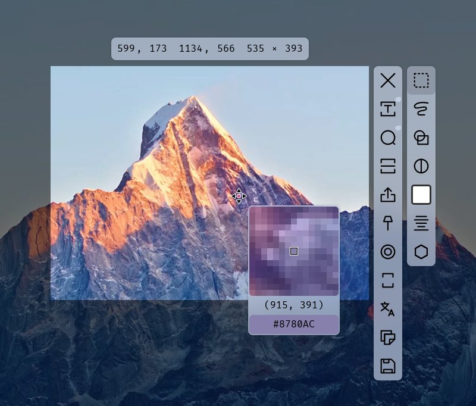
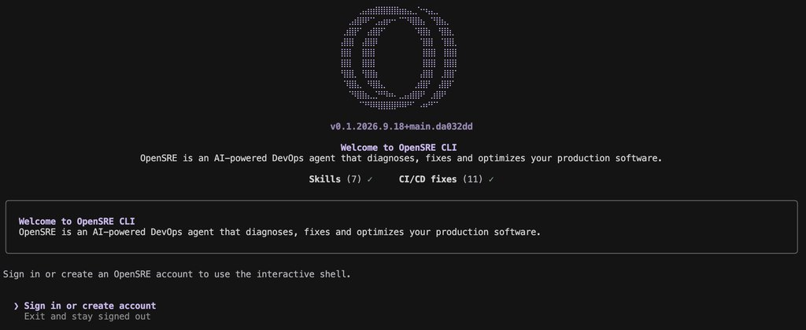
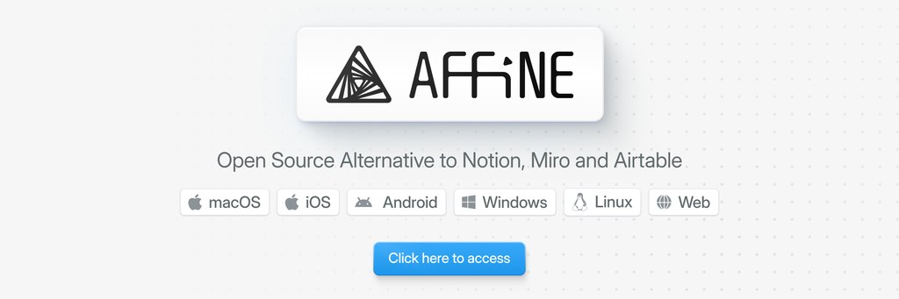

# GitHub Trending 日报 · 2026-11-24

> 2026 年 11 月 24 日 星期二 ｜ 采集时间 2026-11-24 12:30 GMT+8
> 数据来源：[中文榜](https://github.com/trending?since=daily&spoken_language_code=zh) · [全球榜](https://github.com/trending?since=daily)

共收录 **36** 个仓库（中文版 20，全球版 16），今日新增星标合计 **+12,572**。

> **编者按 · 今日观察**
> 全球榜 16 个项目里有 10 个绕着编码 Agent 转：技能包、插件规范、画图与调研 skill、上架自查 playbook。榜单在跟着工具链一起变形——今天涨得最猛的不是模型，是给模型配的手册。

## 今日 Top 5（按今日新增星标）

1. **[elementalsouls/Claude-BugHunter](https://github.com/elementalsouls/Claude-BugHunter)** — +2,029 · 把 Claude 变成挖洞研究员
2. **[XiaoYouChR/Ghost-Downloader-3](https://github.com/XiaoYouChR/Ghost-Downloader-3)** — +1,087 · 什么协议都能下
3. **[firecrawl/firecrawl](https://github.com/firecrawl/firecrawl)** — +924 · 给 Agent 喂网页数据
4. **[zhouxiaoka/autoclip](https://github.com/zhouxiaoka/autoclip)** — +907 · 一个链接一键出片
5. **[obra/superpowers](https://github.com/obra/superpowers)** — +840 · 给编码 Agent 的开发方法论

---

## 一、中文版 · 20 个仓库

来源：<https://github.com/trending?since=daily&spoken_language_code=zh>

| # | 仓库 | 语言 | 星标 | 今日 | 一句话 |
| --- | --- | --- | ---: | ---: | --- |
| 1 | [aoaostar/legado](https://github.com/aoaostar/legado) | HTML | 7,860 | +112 | 「阅读」书源合集 |
| 2 | [higress-group/higress](https://github.com/higress-group/higress) | Go | 9,829 | +12 | 云原生 AI 网关 |
| 3 | [ruanyf/weekly](https://github.com/ruanyf/weekly) | — | 108,621 | +65 | 阮一峰的科技周刊 |
| 4 | [krahets/hello-algo](https://github.com/krahets/hello-algo) | Python | 132,642 | +58 | 动画图解数据结构 |
| 5 | [sngyai/Sequoia-X](https://github.com/sngyai/Sequoia-X) | Python | 8,831 | +24 | 收盘后自动选股推飞书 |
| 6 | [521xueweihan/HelloGitHub](https://github.com/521xueweihan/HelloGitHub) | Python | 190,844 | +237 | 每月推荐入门级开源项目 |
| 7 | [wanglin2/mind-map](https://github.com/wanglin2/mind-map) | JavaScript | 13,049 | +14 | 开源思维导图 |
| 8 | [d2l-ai/d2l-zh](https://github.com/d2l-ai/d2l-zh) | Python | 82,690 | +31 | 可运行的中文深度学习教材 |
| 9 | [XIU2/CloudflareSpeedTest](https://github.com/XIU2/CloudflareSpeedTest) | Go | 30,193 | +41 | 测出最快的 CF IP |
| 10 | [fanmingming/live](https://github.com/fanmingming/live) | JavaScript | 28,958 | +21 | 可直连的台标库 |
| 11 | [hiroi-sora/Umi-OCR](https://github.com/hiroi-sora/Umi-OCR) | Python | 48,911 | +31 | 免费离线截图识字 |
| 12 | [zhayujie/CowAgent](https://github.com/zhayujie/CowAgent) | Python | 48,054 | +14 | 会自己攒记忆的 Agent |
| 13 | [rebase-network/who-is-hiring](https://github.com/rebase-network/who-is-hiring) | HTML | 1,899 | +7 | 免费发布的招聘信息墙 |
| 14 | [jeecgboot/JeecgBoot](https://github.com/jeecgboot/JeecgBoot) | Java | 48,597 | +13 | 一句话生成整套系统 |
| 15 | [xushengfeng/eSearch](https://github.com/xushengfeng/eSearch) | TypeScript | 7,473 | +8 | 截图之后什么都能干 |
| 16 | [pymumu/smartdns](https://github.com/pymumu/smartdns) | C | 11,450 | +9 | 本地 DNS 挑最快 IP |
| 17 | [jaywcjlove/linux-command](https://github.com/jaywcjlove/linux-command) | Markdown | 37,300 | +16 | 600+ 命令速查手册 |
| 18 | [JoeanAmier/TikTokDownloader](https://github.com/JoeanAmier/TikTokDownloader) | JavaScript | 17,662 | +32 | 抖音作品下载与采集 |
| 19 | [xifangczy/cat-catch](https://github.com/xifangczy/cat-catch) | JavaScript | 23,150 | +31 | 浏览器资源嗅探 |
| 20 | [xfangfang/wiliwili](https://github.com/xfangfang/wiliwili) | C++ | 5,742 | +5 | 掌机上的 B 站客户端 |

### 1. aoaostar / legado

> 阅读APP书源

**导读**：给「阅读」App 用的书源与订阅源大合集，另附主题与排版配置。仓库本身不能一键导入，得去配套站点 legado.aoaostar.com 逐条添加。

- 语言：HTML
- 星标：7,860（今日 +112）
- 标签：「阅读」书源合集
- 仓库：<https://github.com/aoaostar/legado>

### 2. higress-group / higress

> 🤖 AI Gateway | AI Native API Gateway

**导读**：基于 Istio 与 Envoy 的网关，可用 Go/Rust/JS 写 Wasm 插件扩展。README 首页已把 MCP Server 快速上手摆到显眼位置，定位明显在往 AI 流量入口偏。

- 语言：Go
- 星标：9,829（今日 +12）
- 标签：云原生 AI 网关
- 仓库：<https://github.com/higress-group/higress>

### 3. ruanyf / weekly

> 科技爱好者周刊，每周五发布

**导读**：每周五更新的科技周刊，当周值得一读的文章、工具与资源都收在 issue 里。星标十万加，是中文技术圈活得最久的个人周刊。

- 语言：—
- 星标：108,621（今日 +65）
- 标签：阮一峰的科技周刊
- 仓库：<https://github.com/ruanyf/weekly>

### 4. krahets / hello-algo

> 《Hello 算法》：动画图解、一键运行的数据结构与算法教程。支持简中、繁中、English、日本語，提供 Python, Java, C++, C, C#, JS, Go, Swift, Rust, Ruby, Kotlin, TS, Dart 等代码实现

**导读**：用动画图解配可运行代码讲数据结构与算法，简中、繁中、英、日四语并行，附十余种语言实现。十三万星，仍是中文算法入门的第一站。

- 语言：Python
- 星标：132,642（今日 +58）
- 标签：动画图解数据结构
- 仓库：<https://github.com/krahets/hello-algo>

### 5. sngyai / Sequoia-X

> A股自动选股系统 — 多种技术形态自动扫描，收盘后自动运行并推送飞书

**导读**：面向 A 股的量化选股系统，V2 按 OOP 与向量化计算重写了一遍。数据走 baostock 存本地 SQLite 绕开东财反爬，收盘后自动跑并推飞书群。

- 语言：Python
- 星标：8,831（今日 +24）
- 标签：收盘后自动选股推飞书
- 仓库：<https://github.com/sngyai/Sequoia-X>

### 6. 521xueweihan / HelloGitHub

> 分享 GitHub 上有趣、入门级的开源项目。Share interesting, entry-level open source projects on GitHub.

**导读**：每月 28 号发刊的开源月刊，挑有趣、入门级的项目与开源书、实战工程。十九万星，今日中文榜涨得最猛的一个。

- 语言：Python
- 星标：190,844（今日 +237）
- 标签：每月推荐入门级开源项目
- 仓库：<https://github.com/521xueweihan/HelloGitHub>

### 7. wanglin2 / mind-map

> SimpleMindMap（思绪思维导图）：一个强大的思维导图。A powerful mind map.

**导读**：SimpleMindMap：开源的是 JavaScript 库，可以嵌进自己的项目；桌面客户端闭源。支持多种结构、主题与导出格式。

- 语言：JavaScript
- 星标：13,049（今日 +14）
- 标签：开源思维导图
- 仓库：<https://github.com/wanglin2/mind-map>

### 8. d2l-ai / d2l-zh

> 《动手学深度学习》：面向中文读者、能运行、可讨论。中英文版被70多个国家的500多所大学用于教学。

**导读**：《动手学深度学习》中文版，概念、背景、数学与代码在同一处讲完，notebook 全部可跑。中英文版进了 70 多个国家 500 多所大学的课堂。

- 语言：Python
- 星标：82,690（今日 +31）
- 标签：可运行的中文深度学习教材
- 仓库：<https://github.com/d2l-ai/d2l-zh>

### 9. XIU2 / CloudflareSpeedTest

> 🌩「自选优选 IP」测试 Cloudflare CDN 延迟和速度，获取最快 IP ！当然也支持其他 CDN / 多个解析 IP 的网站 ~

**导读**：Cloudflare 公开了全部 IP 段，但哪一段对国内访客友好得自己试。这个工具批量测延迟与速度，挑出最快的 IPv4/IPv6，也支持其他 CDN。

- 语言：Go
- 星标：30,193（今日 +41）
- 标签：测出最快的 CF IP
- 仓库：<https://github.com/XIU2/CloudflareSpeedTest>

### 10. fanmingming / live

> ✯ 可直连访问的电视/广播图标库与相关工具项目 ✯ 🔕 永久免费 直连访问 完整开源 不断完善的台标 支持IPv4/IPv6双栈访问 🔕

**导读**：电视与广播的台标图标库，配套 IPTV 播放列表与相关工具，全部可直连访问。IPv4/IPv6 双栈，台标持续在补。

- 语言：JavaScript
- 星标：28,958（今日 +21）
- 标签：可直连的台标库
- 仓库：<https://github.com/fanmingming/live>

### 11. hiroi-sora / Umi-OCR

> OCR software, free and offline. 开源、免费的离线OCR软件。支持截屏/批量导入图片，PDF文档识别，排除水印/页眉页脚，扫描/生成二维码。内置多国语言库。

**导读**：离线 OCR：截屏、批量导图、整份 PDF 都能识别，还能排掉水印与页眉页脚、扫描或生成二维码。多国语言库内置，不联网也能用。

- 语言：Python
- 星标：48,911（今日 +31）
- 标签：免费离线截图识字
- 仓库：<https://github.com/hiroi-sora/Umi-OCR>

### 12. zhayujie / CowAgent

> Open-source personal AI assistant & Agent Harness. Plans tasks, runs tools and skills, self-evolves with memory and knowledge. Multi-agent, multi-model, multi-channel. Lightweight, extensible, one-line install.

**导读**：从 chatgpt-on-wechat 一路演进来的个人 Agent：会拆任务、调工具与 MCP，靠长期记忆和知识库慢慢认识你。多模型、多渠道，一行命令装。

- 语言：Python
- 星标：48,054（今日 +14）
- 标签：会自己攒记忆的 Agent
- 仓库：<https://github.com/zhayujie/CowAgent>

### 13. rebase-network / who-is-hiring

> 这个仓库是由 Rebase 社区创建的，为区块链行业以及其他各行各业的企业和团队提供招聘信息披露机会，所有招聘信息都将在 Rebase 社区的所有媒体上进行发表。这都是免费的！

**导读**：Rebase 社区维护的招聘信息墙，区块链与其他行业的团队都能免费发 JD，开个 issue 就自动挂到页面上。

- 语言：HTML
- 星标：1,899（今日 +7）
- 标签：免费发布的招聘信息墙
- 仓库：<https://github.com/rebase-network/who-is-hiring>

### 14. jeecgboot / JeecgBoot

> 一款免费开源的 AI 低代码平台，也是 AI 时代构建复杂业务系统的开源基座！权限、多租户、工作流、报表、大屏、AI 知识库等通用能力开箱即用，AI 只需生成业务差异部分。AI Skills 一句话生成完整系统——建表、前后端代码、菜单权限、BPM 流程、表单、报表、大屏全自动。内置 AI 应用平台（聊天、知识库、流程编排、MCP），兼容主流大模型

**导读**：AI 低代码平台：AI Skills 用一句话生成建表 SQL、前后端代码、菜单权限、BPM 流程与报表大屏。权限、多租户、知识库这些底座开箱即用。

- 语言：Java
- 星标：48,597（今日 +13）
- 标签：一句话生成整套系统
- 仓库：<https://github.com/jeecgboot/JeecgBoot>

### 15. xushengfeng / eSearch

> 截屏 离线OCR 搜索翻译 以图搜图 贴图 录屏 万向滚动截屏 屏幕翻译 Screenshot Offline OCR Search Translate Search for picture Paste the picture on the screen Screen recorder Omnidirectional scrolling screenshot Screen translator 支持Windows Linux macOS

**导读**：Electron 写的截图工具，截完能离线 OCR、翻译、以图搜图、贴图、录屏、万向滚动截屏。Windows/Linux/macOS 全平台。

- 语言：TypeScript
- 星标：7,473（今日 +8）
- 标签：截图之后什么都能干
- 仓库：<https://github.com/xushengfeng/eSearch>

### 16. pymumu / smartdns

> A local DNS server to obtain the fastest website IP for the best Internet experience, support DoT, DoH, DoQ. 一个本地DNS服务器，获取最快的网站IP，获得最佳上网体验，支持DoH，DoT，DoQ。

**导读**：本地 DNS 服务器，支持 DoT/DoH/DoQ，按测速结果把域名解析到最快的那个 IP，顺手还能挡广告。

- 语言：C
- 星标：11,450（今日 +9）
- 标签：本地 DNS 挑最快 IP
- 仓库：<https://github.com/pymumu/smartdns>

### 17. jaywcjlove / linux-command

> Linux命令大全搜索工具，内容包含Linux命令手册、详解、学习、搜集。https://git.io/linux

**导读**：六百多条 Linux 命令的手册、详解与示例，配一个无广告的查询网站。忘了参数怎么拼的时候，比翻 man 快。

- 语言：Markdown
- 星标：37,300（今日 +16）
- 标签：600+ 命令速查手册
- 仓库：<https://github.com/jaywcjlove/linux-command>

### 18. JoeanAmier / TikTokDownloader

> 抖音 / TikTok 平台作品下载/数据采集工具

**导读**：抖音与 TikTok 的作品下载、账号数据采集工具。支持 Fork 后走 GitHub Actions 自动构建打包，省掉本地配环境。

- 语言：JavaScript
- 星标：17,662（今日 +32）
- 标签：抖音作品下载与采集
- 仓库：<https://github.com/JoeanAmier/TikTokDownloader>

### 19. xifangczy / cat-catch

> 猫抓 浏览器资源嗅探扩展 / cat-catch Browser Resource Sniffing Extension

**导读**：猫抓：把当前页面加载的音视频、图片资源全列出来，筛选后直接下载。Chrome、Edge、Firefox 都有得装。

- 语言：JavaScript
- 星标：23,150（今日 +31）
- 标签：浏览器资源嗅探
- 仓库：<https://github.com/xifangczy/cat-catch>

### 20. xfangfang / wiliwili

> 第三方B站客户端，目前可以运行在PC全平台、PSVita、PS4 、Xbox 和 Nintendo Switch上

**导读**：第三方 B 站客户端，跑在 PC、PSVita、PS4、Xbox 与 Switch 上，触屏、键鼠、手柄都能操作，简繁日韩英五语界面。

- 语言：C++
- 星标：5,742（今日 +5）
- 标签：掌机上的 B 站客户端
- 仓库：<https://github.com/xfangfang/wiliwili>

---

## 二、全球版 · 16 个仓库

来源：<https://github.com/trending?since=daily>

| # | 仓库 | 语言 | 星标 | 今日 | 一句话 |
| --- | --- | --- | ---: | ---: | --- |
| 1 | [elementalsouls/Claude-BugHunter](https://github.com/elementalsouls/Claude-BugHunter) | Python | 20,022 | +2,029 | 把 Claude 变成挖洞研究员 |
| 2 | [obra/superpowers](https://github.com/obra/superpowers) | Shell | 325,220 | +840 | 给编码 Agent 的开发方法论 |
| 3 | [HKUDS/CLI-Anything](https://github.com/HKUDS/CLI-Anything) | Python | 63,859 | +790 | 让软件都能被 Agent 调用 |
| 4 | [jingyaogong/minimind](https://github.com/jingyaogong/minimind) | Python | 69,617 | +828 | 两小时训出 64M 小模型 |
| 5 | [cursor/plugins](https://github.com/cursor/plugins) | TypeScript | 18,875 | +397 | Cursor 官方插件集 |
| 6 | [firecrawl/firecrawl](https://github.com/firecrawl/firecrawl) | TypeScript | 208,071 | +924 | 给 Agent 喂网页数据 |
| 7 | [nginx/nginx](https://github.com/nginx/nginx) | C | 33,082 | +174 | NGINX 官方源码库 |
| 8 | [openvinotoolkit/openvino](https://github.com/openvinotoolkit/openvino) | C++ | 12,316 | +184 | 优化并部署推理 |
| 9 | [cathrynlavery/diagram-design](https://github.com/cathrynlavery/diagram-design) | HTML | 71,115 | +620 | 不套模板的图表设计 |
| 10 | [mvanhorn/last30days-skill](https://github.com/mvanhorn/last30days-skill) | Python | 73,558 | +797 | 按点赞数排序的搜索 |
| 11 | [google-labs-code/stitch-skills](https://github.com/google-labs-code/stitch-skills) | TypeScript | 12,370 | +422 | Stitch 的设计技能库 |
| 12 | [mjmirza/app-store-compliance](https://github.com/mjmirza/app-store-compliance) | Shell | 5,099 | +761 | 上架前先自查一遍 |
| 13 | [Tracer-Cloud/opensre](https://github.com/Tracer-Cloud/opensre) | Python | 14,886 | +436 | CI/CD 可靠性 Agent |
| 14 | [toeverything/AFFiNE](https://github.com/toeverything/AFFiNE) | TypeScript | 77,483 | +595 | 文档白板二合一 |
| 15 | [XiaoYouChR/Ghost-Downloader-3](https://github.com/XiaoYouChR/Ghost-Downloader-3) | Python | 16,499 | +1,087 | 什么协议都能下 |
| 16 | [zhouxiaoka/autoclip](https://github.com/zhouxiaoka/autoclip) | Python | 14,610 | +907 | 一个链接一键出片 |

### 1. elementalsouls / Claude-BugHunter

> A Claude Code skill bundle for bug hunting and external red-team work - 84 skills, 15 slash commands, 681 disclosed-report patterns curated across 24 core vulnerability classes, plus enterprise identity + infrastructure attack matrices.

**导读**：给 Claude Code 装的技能包：84 个 skill、15 条斜杠命令，按 24 类漏洞整理了 681 个已公开报告的套路，另附企业身份与基础设施的攻击矩阵。今日全球榜第一。

- 语言：Python
- 星标：20,022（今日 +2,029）
- 标签：把 Claude 变成挖洞研究员
- 仓库：<https://github.com/elementalsouls/Claude-BugHunter>

### 2. obra / superpowers

> An agentic skills framework & software development methodology that works.

**导读**：不让 Agent 直接开写，而是先退一步问清你到底要做什么，再按一套可组合的 skill 走完流程。三十二万星，这类框架里最出圈的一个。

- 语言：Shell
- 星标：325,220（今日 +840）
- 标签：给编码 Agent 的开发方法论
- 仓库：<https://github.com/obra/superpowers>

### 3. HKUDS / CLI-Anything

> "CLI-Anything: Making ALL Software Agent-Native" -- CLI-Hub: https://clianything.cc/

**导读**：把图形界面软件包一层 CLI，Agent 就能直接调。配套 CLI-Hub 可浏览安装社区做的 CLI，pip 一行装好。

- 语言：Python
- 星标：63,859（今日 +790）
- 标签：让软件都能被 Agent 调用
- 仓库：<https://github.com/HKUDS/CLI-Anything>

### 4. jingyaogong / minimind

> 🧠 两小时从 0 训出你的 64M 大模型。Train your own 64M LLM from scratch in 2 hours.

**导读**：从零手写一遍 64M 参数 LLM 的完整流程，两小时单卡跑得完。想搞清楚预训练、SFT、LoRA 各自在做什么，这是最短的一条路。

- 语言：Python
- 星标：69,617（今日 +828）
- 标签：两小时训出 64M 小模型
- 仓库：<https://github.com/jingyaogong/minimind>

### 5. cursor / plugins

> Cursor plugin specification and official plugins

**导读**：Cursor 的插件规范与官方插件库，每个插件是根目录下一个独立文件夹，带 .cursor-plugin/plugin.json 清单。想给自己工具接 Cursor，照这个结构抄就行。

- 语言：TypeScript
- 星标：18,875（今日 +397）
- 标签：Cursor 官方插件集
- 仓库：<https://github.com/cursor/plugins>

### 6. firecrawl / firecrawl

> Knowledge infrastructure to make your agents smarter. Search, scrape and access 550+ data providers through one API.

**导读**：一个 API 打通搜索、抓取与 550 多个数据源，输出干净的 markdown 喂给模型。仓库里是自托管服务与各语言 SDK。

- 语言：TypeScript
- 星标：208,071（今日 +924）
- 标签：给 Agent 喂网页数据
- 仓库：<https://github.com/firecrawl/firecrawl>

### 7. nginx / nginx

> The official NGINX Open Source repository.

**导读**：官方源码终于单独开了一个仓库。全球最常用的 Web 服务器，兼反向代理、负载均衡、API 网关与内容缓存，BSD 类许可证。

- 语言：C
- 星标：33,082（今日 +174）
- 标签：NGINX 官方源码库
- 仓库：<https://github.com/nginx/nginx>

### 8. openvinotoolkit / openvino

> OpenVINO™ is an open source toolkit for optimizing and deploying AI inference

**导读**：Intel 主导的推理优化与部署工具包，把训好的模型压到 CPU、核显、NPU 上跑。附一份速查表与关键特性清单。

- 语言：C++
- 星标：12,316（今日 +184）
- 标签：优化并部署推理
- 仓库：<https://github.com/openvinotoolkit/openvino>

### 9. cathrynlavery / diagram-design

> Editorial diagram design for Claude Code, Codex, GitHub Copilot, Cursor, Factory Droid, Qoder, and Pi. 52 diagram types. Self-contained HTML + SVG. No shadows. No Mermaid slop.

**导读**：给编码 Agent 的画图 skill：产出单文件 HTML + SVG，52 种图表类型，按你的品牌配色。作者明确说不要阴影、不要 Mermaid 味。

- 语言：HTML
- 星标：71,115（今日 +620）
- 标签：不套模板的图表设计
- 仓库：<https://github.com/cathrynlavery/diagram-design>

### 10. mvanhorn / last30days-skill

> AI agent skill that researches any topic across Reddit, X, YouTube, HN, Polymarket, and the web - then synthesizes a grounded summary

**导读**：让 Agent 去 Reddit、X、YouTube、HN、Polymarket 上扒最近 30 天的讨论，按点赞与真实下注金额排序，再合成一份带出处的结论。

- 语言：Python
- 星标：73,558（今日 +797）
- 标签：按点赞数排序的搜索
- 仓库：<https://github.com/mvanhorn/last30days-skill>

### 11. google-labs-code / stitch-skills

> A library of Agent Skills designed to work with the Stitch MCP server. Each skill follows the Agent Skills open standard, for compatibility with coding agents such as Antigravity, Gemini CLI, Claude Code, Cursor.

**导读**：Google Stitch 的 Agent Skills 合集，遵循 Agent Skills 开放标准，Claude Code、Gemini CLI、Cursor、Codex 都能直接用。

- 语言：TypeScript
- 星标：12,370（今日 +422）
- 标签：Stitch 的设计技能库
- 仓库：<https://github.com/google-labs-code/stitch-skills>

### 12. mjmirza / app-store-compliance

> Avoid common App Store and Google Play rejections. Open playbook and pre-submission guard with 124 documented rejection patterns and fixes, privacy manifest and Data safety checks, 112 tracked deadlines (EU AI Act, DSA, COPPA, age laws), and a skill for AI coding agents.

**导读**：124 条 App Store 与 Google Play 的真实拒审原因及改法，加隐私清单与数据安全自查，还盯着 112 个合规截止日（EU AI Act、DSA、COPPA 等）。

- 语言：Shell
- 星标：5,099（今日 +761）
- 标签：上架前先自查一遍
- 仓库：<https://github.com/mjmirza/app-store-compliance>

### 13. Tracer-Cloud / opensre

> The open-source agent for CI/CD reliability.

**导读**：开源的 CI/CD 可靠性 Agent：流水线挂了先去翻日志定位根因，而不是让人从头 grep 起。

- 语言：Python
- 星标：14,886（今日 +436）
- 标签：CI/CD 可靠性 Agent
- 仓库：<https://github.com/Tracer-Cloud/opensre>

### 14. toeverything / AFFiNE

> There can be more than Notion and Miro. AFFiNE(pronounced [ə‘fain]) is a next-gen knowledge base that brings planning, sorting and creating all together. Privacy first, open-source, customizable and ready to use.

**导读**：Notion 与 Miro 的开源替代，文档、白板、数据库放在同一块画布上，本地优先、可自托管。

- 语言：TypeScript
- 星标：77,483（今日 +595）
- 标签：文档白板二合一
- 仓库：<https://github.com/toeverything/AFFiNE>

### 15. XiaoYouChR / Ghost-Downloader-3

> The only downloader you need. 下载器的集大成者。

**导读**：从帮 B 站 UP 主整理资源起家，现在四个平台都能跑，BT、磁力、直链几乎通吃，还长出了 Feature Packs 插件生态。今日全球榜涨幅第二。

- 语言：Python
- 星标：16,499（今日 +1,087）
- 标签：什么协议都能下
- 仓库：<https://github.com/XiaoYouChR/Ghost-Downloader-3>

### 16. zhouxiaoka / autoclip

> AutoClip｜一个链接，一键出片。开源 AI 视频剪辑桌面工具，将播客、访谈、课程等长视频自动剪成短视频，生成字幕、封面和发布文案，适配抖音、小红书、TikTok、Reels 与 YouTube Shorts。Open-source AI video clipping & content repurposing.

**导读**：开源 AI 剪辑桌面工具：贴一个视频链接，自动切出短视频，配字幕、封面与发布文案，适配抖音、小红书、TikTok、Reels。剪辑渲染都在本机跑。

- 语言：Python
- 星标：14,610（今日 +907）
- 标签：一个链接一键出片
- 仓库：<https://github.com/zhouxiaoka/autoclip>

---

## 说明

- 榜单顺序与字段取自 GitHub Trending 每日榜（since=daily），星标数与「今日新增」为采集时刻页面展示值。
- 「简介」为仓库在 GitHub 上的原始描述；「导读」为基于 README 的整理与中文编译，非逐字翻译。
- 配图取自仓库 README，已等比缩放并转存为 jpg（最长边 ≤ 1024px、单张 < 1MB）；文中路径相对于项目根目录，版权归原作者所有。
- 网页版：打开 `index.html`，右上角切换「日报 / 周报」与日期。
- 本文档由 `tools/build-report.js` 于 2026/11/24 12:40:44 生成。
