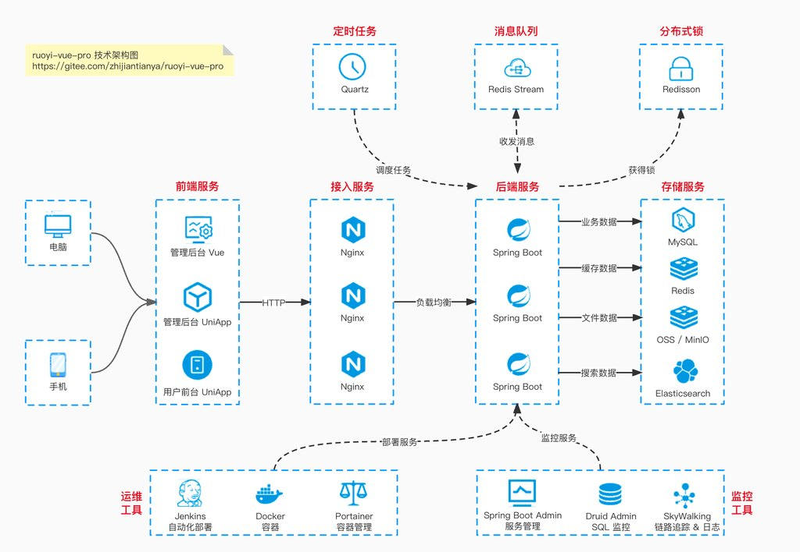
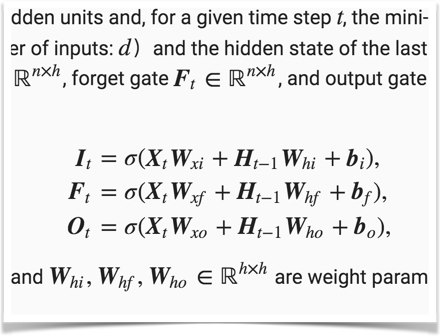
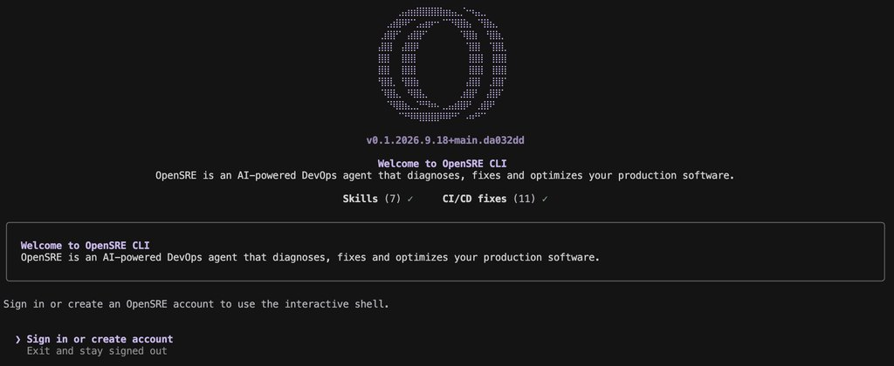
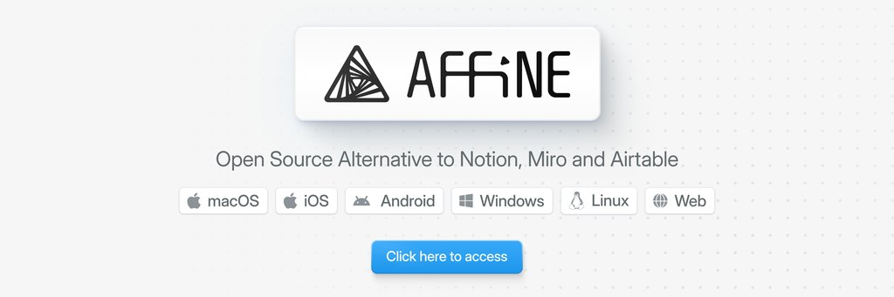

# GitHub Trending 日报 · 2026-11-27

> 2026 年 11 月 27 日 星期五 ｜ 采集时间 2026-11-27 12:30 GMT+8
> 数据来源：[中文榜](https://github.com/trending?since=daily&spoken_language_code=zh) · [全球榜](https://github.com/trending?since=daily)

共收录 **37** 个仓库（中文版 21，全球版 16），今日新增星标合计 **+11,299**。

> **编者按 · 今日观察**
> 两个榜单连续第二天一字未动：中文 21 位、全球 16 位与昨天完全相同，全球榜已经第四天保持这个顺序。但速度全线回落——37 个仓库的「今日新增」无一例外低于昨天，合计 +11,299，比昨天的 13,199 少了一千九（-14.4%）。掉得最狠的是 CLI-Anything（+1,106 → +746）和 app-store-compliance（+858 → +562）；少数逆势的是 ruoyi-vue-pro（+20 → +31）、TikTokDownloader（+21 → +32）、CowAgent（+16 → +27）。名次是滞后的，这种「位次不动、油门松开」才是榜单真实的呼吸。

## 今日 Top 5（按今日新增星标）

1. **[elementalsouls/Claude-BugHunter](https://github.com/elementalsouls/Claude-BugHunter)** — +1,597 · 给 Claude 装挖洞技能
2. **[firecrawl/firecrawl](https://github.com/firecrawl/firecrawl)** — +1,046 · 把网页变成干净文本
3. **[cathrynlavery/diagram-design](https://github.com/cathrynlavery/diagram-design)** — +955 · 不套模板的画图 skill
4. **[XiaoYouChR/Ghost-Downloader-3](https://github.com/XiaoYouChR/Ghost-Downloader-3)** — +889 · 一个下载器走天下
5. **[obra/superpowers](https://github.com/obra/superpowers)** — +854 · 先问清楚再动手

---

## 一、中文版 · 21 个仓库

来源：<https://github.com/trending?since=daily&spoken_language_code=zh>

| # | 仓库 | 语言 | 星标 | 今日 | 一句话 |
| --- | --- | --- | ---: | ---: | --- |
| 1 | [aoaostar/legado](https://github.com/aoaostar/legado) | HTML | 8,001 | +41 | 书源与排版配置 |
| 2 | [higress-group/higress](https://github.com/higress-group/higress) | Go | 9,864 | +14 | Wasm 插件网关 |
| 3 | [ruanyf/weekly](https://github.com/ruanyf/weekly) | — | 108,814 | +56 | 周五发刊的周刊 |
| 4 | [krahets/hello-algo](https://github.com/krahets/hello-algo) | Python | 132,767 | +46 | 动画图解算法书 |
| 5 | [sngyai/Sequoia-X](https://github.com/sngyai/Sequoia-X) | Python | 8,890 | +14 | 收盘后自动选股 |
| 6 | [521xueweihan/HelloGitHub](https://github.com/521xueweihan/HelloGitHub) | Python | 191,483 | +195 | 每月 28 号的月刊 |
| 7 | [wanglin2/mind-map](https://github.com/wanglin2/mind-map) | JavaScript | 13,088 | +13 | 可嵌入的导图库 |
| 8 | [YunaiV/ruoyi-vue-pro](https://github.com/YunaiV/ruoyi-vue-pro) | Java | 40,664 | +31 | Spring Boot 后台底座 |
| 9 | [d2l-ai/d2l-zh](https://github.com/d2l-ai/d2l-zh) | Python | 82,763 | +28 | 第二版中文教材 |
| 10 | [XIU2/CloudflareSpeedTest](https://github.com/XIU2/CloudflareSpeedTest) | Go | 30,285 | +34 | 挑出最快的 CDN IP |
| 11 | [fanmingming/live](https://github.com/fanmingming/live) | JavaScript | 28,987 | +10 | 台标与直播源 |
| 12 | [hiroi-sora/Umi-OCR](https://github.com/hiroi-sora/Umi-OCR) | Python | 49,027 | +29 | 不联网也能识字 |
| 13 | [zhayujie/CowAgent](https://github.com/zhayujie/CowAgent) | Python | 48,103 | +27 | 会攒记忆的个人 Agent |
| 14 | [rebase-network/who-is-hiring](https://github.com/rebase-network/who-is-hiring) | HTML | 1,910 | +7 | 免费招聘信息墙 |
| 15 | [jeecgboot/JeecgBoot](https://github.com/jeecgboot/JeecgBoot) | Java | 48,641 | +12 | 一句话生成系统 |
| 16 | [xushengfeng/eSearch](https://github.com/xushengfeng/eSearch) | TypeScript | 7,507 | +12 | 截图之后还能干嘛 |
| 17 | [pymumu/smartdns](https://github.com/pymumu/smartdns) | C | 11,464 | +5 | 本地 DNS 择优 |
| 18 | [jaywcjlove/linux-command](https://github.com/jaywcjlove/linux-command) | Markdown | 37,339 | +14 | 600 多条命令速查 |
| 19 | [JoeanAmier/TikTokDownloader](https://github.com/JoeanAmier/TikTokDownloader) | JavaScript | 17,725 | +32 | 抖音作品采集 |
| 20 | [xifangczy/cat-catch](https://github.com/xifangczy/cat-catch) | JavaScript | 23,227 | +29 | 把页面资源列出来 |
| 21 | [xfangfang/wiliwili](https://github.com/xfangfang/wiliwili) | C++ | 5,766 | +9 | 掌机上的 B 站 |

### 1. aoaostar / legado

> 阅读APP书源

**导读**：「阅读」App 的小说书源、订阅源、主题与排版配置合集，八千古星。README 短得只有两行，重点只有一句：Git 仓库不支持一键导入，得去 legado.aoaostar.com 逐条添加。今日 +41，比昨天又慢了三个，中文榜第一的位置靠存量守着。

- 语言：HTML
- 星标：8,001（今日 +41）
- 标签：书源与排版配置
- 仓库：<https://github.com/aoaostar/legado>

### 2. higress-group / higress

> 🤖 AI Gateway | AI Native API Gateway

**导读**：基于 Istio 与 Envoy 的云原生 API 网关，插件用 Go/Rust/JS 写成 Wasm 热加载，自带几十个开箱可用的通用插件和在线 Demo 控制台。今日只有 +14——中文榜第二名，却是全场涨得第二慢的一个，说明它在榜上待的是「老面孔」的位置。

- 语言：Go
- 星标：9,864（今日 +14）
- 标签：Wasm 插件网关
- 仓库：<https://github.com/higress-group/higress>

### 3. ruanyf / weekly

> 科技爱好者周刊，每周五发布

**导读**：科技爱好者周刊，每周五发布，十万八千星。今天是周五，正好是它该发新一期的时间，所以今日 +56 比昨天的 +71 稍缓，可能是在等发刊后的那一波。投稿照例走 issue，正文里文章、软件、资源三类分开列。

- 语言：—
- 星标：108,814（今日 +56）
- 标签：周五发刊的周刊
- 仓库：<https://github.com/ruanyf/weekly>

### 4. krahets / hello-algo

> 《Hello 算法》：动画图解、一键运行的数据结构与算法教程。支持简中、繁中、English、日本語，提供 Python, Java, C++, C, C#, JS, Go, Swift, Rust, Ruby, Kotlin, TS, Dart 等代码实现

**导读**：《Hello 算法》：动画图解加一键运行的数据结构与算法教程，简中、繁中、英、日四语并行，代码实现覆盖 Python、Java、C++、C、C#、JS、Go、Swift、Rust、Ruby、Kotlin、TS、Dart。十三万星，今日 +46，仍是中文榜上唯一一本完整的入门教材。

- 语言：Python
- 星标：132,767（今日 +46）
- 标签：动画图解算法书
- 仓库：<https://github.com/krahets/hello-algo>

### 5. sngyai / Sequoia-X

> A股自动选股系统 — 多种技术形态自动扫描，收盘后自动运行并推送飞书

**导读**：A 股量化选股系统，V2 版按现代 Python 工程规范从零重构，OOP 架构加向量化计算、增量更新。行情走 baostock 拉后复权日 K（免费、不限流），存本地 SQLite 绕开东财反爬，收盘后自动扫技术形态并推飞书群。今日 +14，比昨天的 +28 少了一半。

- 语言：Python
- 星标：8,890（今日 +14）
- 标签：收盘后自动选股
- 仓库：<https://github.com/sngyai/Sequoia-X>

### 6. 521xueweihan / HelloGitHub

> 分享 GitHub 上有趣、入门级的开源项目。Share interesting, entry-level open source projects on GitHub.

**导读**：每月 28 号发刊的开源月刊，挑入门级项目、开源书、实战与企业级工程，官网和公众号两条阅读路径。今天 27 号，明天就该更新一期了。十九万星，今日 +195，仍是中文榜涨得最快的一个，但比昨天的 +252 少了五十七。

- 语言：Python
- 星标：191,483（今日 +195）
- 标签：每月 28 号的月刊
- 仓库：<https://github.com/521xueweihan/HelloGitHub>

### 7. wanglin2 / mind-map

> SimpleMindMap（思绪思维导图）：一个强大的思维导图。A powerful mind map.

**导读**：SimpleMindMap（思绪思维导图），仓库分两半：开源的 JavaScript 思维导图库，能直接嵌进自己的项目；桌面客户端是闭源的。README 就一句话交代这个结构，剩下的都写在文档站里。今日 +13。

- 语言：JavaScript
- 星标：13,088（今日 +13）
- 标签：可嵌入的导图库
- 仓库：<https://github.com/wanglin2/mind-map>

### 8. YunaiV / ruoyi-vue-pro

> 🔥 官方推荐 🔥 RuoYi-Vue 全新 Pro 版本，优化重构所有功能。基于 Spring Boot + MyBatis Plus + Vue & Element 实现的后台管理系统 + 微信小程序，支持 RBAC 动态权限、数据权限、SaaS 多租户、Flowable 工作流、三方登录、支付、短信、商城、CRM、ERP、MES、IM、AI 大模型、IoT 物联网等功能。你的 ⭐️ Star ⭐️，是作者生发的动力！

**导读**：RuoYi-Vue 的 Pro 版，Spring Boot + MyBatis Plus + Vue & Element，RBAC 动态权限、数据权限、SaaS 多租户、Flowable 工作流、三方登录、支付短信商城 CRM ERP MES IM AI 大模型 IoT 一路铺开。四万星。今日 +31，是榜上少数逆势的一个（昨天 +20）。

- 语言：Java
- 星标：40,664（今日 +31）
- 标签：Spring Boot 后台底座
- 仓库：<https://github.com/YunaiV/ruoyi-vue-pro>

### 9. d2l-ai / d2l-zh

> 《动手学深度学习》：面向中文读者、能运行、可讨论。中英文版被70多个国家的500多所大学用于教学。

**导读**：《动手学深度学习》中文第二版，概念、背景知识与代码在同一章讲完，notebook 全部可跑。README 自述得克制：中英文版被 70 多个国家 500 多所大学用于教学。今日 +28，比昨天的 +20 反而快了八星。

- 语言：Python
- 星标：82,763（今日 +28）
- 标签：第二版中文教材
- 仓库：<https://github.com/d2l-ai/d2l-zh>

### 10. XIU2 / CloudflareSpeedTest

> 🌩「自选优选 IP」测试 Cloudflare CDN 延迟和速度，获取最快 IP ！当然也支持其他 CDN / 多个解析 IP 的网站 ~

**导读**：Cloudflare 把 IP 段全公开了，但哪一段对内地访客好用只能自己测。这个工具批量压延迟与下载速度，从 IPv4/IPv6 里挑出最快的写进配置，也支持别的 CDN 或多个解析 IP 的站点。README 里作者直接讨星，今日 +34，几乎与昨天持平。

- 语言：Go
- 星标：30,285（今日 +34）
- 标签：挑出最快的 CDN IP
- 仓库：<https://github.com/XIU2/CloudflareSpeedTest>

### 11. fanmingming / live

> ✯ 可直连访问的电视/广播图标库与相关工具项目 ✯ 🔕 永久免费 直连访问 完整开源 不断完善的台标 支持IPv4/IPv6双栈访问 🔕

**导读**：可直连访问的电视与广播图标库，顺带维护 IPTV 播放列表与配套工具，IPv4/IPv6 双栈。README 从「使用方法」直接开讲，没有一句铺垫——它是资源库不是教程，拿来就用。今日 +10。

- 语言：JavaScript
- 星标：28,987（今日 +10）
- 标签：台标与直播源
- 仓库：<https://github.com/fanmingming/live>

### 12. hiroi-sora / Umi-OCR

> OCR software, free and offline. 开源、免费的离线OCR软件。支持截屏/批量导入图片，PDF文档识别，排除水印/页眉页脚，扫描/生成二维码。内置多国语言库。

**导读**：开源免费的离线 OCR：截屏、批量导图、整份 PDF 都能读，能排除水印与页眉页脚、识别或生成二维码，内置多国语言库。Windows 上除了 7z 自解压包，也能用 Scoop 一条命令装。今日 +29，比昨天的 +45 掉了十六。

- 语言：Python
- 星标：49,027（今日 +29）
- 标签：不联网也能识字
- 仓库：<https://github.com/hiroi-sora/Umi-OCR>

### 13. zhayujie / CowAgent

> Open-source personal AI assistant & Agent Harness. Plans tasks, runs tools and skills, self-evolves with memory and knowledge. Multi-agent, multi-model, multi-channel. Lightweight, extensible, one-line install.

**导读**：从 chatgpt-on-wechat 长出来的个人 AI Agent：主动拆任务、调工具技能与 MCP，靠长期记忆、知识库和自我演化慢慢认识你。自我定位是 Agent Harness，多智能体多模型多渠道，一行命令装，README 备了英中日繁四语。今日 +27，比昨天快十一个。

- 语言：Python
- 星标：48,103（今日 +27）
- 标签：会攒记忆的个人 Agent
- 仓库：<https://github.com/zhayujie/CowAgent>

### 14. rebase-network / who-is-hiring

> 这个仓库是由 Rebase 社区创建的，为区块链行业以及其他各行各业的企业和团队提供招聘信息披露机会，所有招聘信息都将在 Rebase 社区的所有媒体上进行发表。这都是免费的！

**导读**：Rebase 社区维护的招聘墙，区块链与其他行业的团队都能免费发 JD：开一个 issue 填上岗位，链接会自动挂到页面上，并同步到社区各渠道。全榜星标最少（1,910），今日 +7，却是唯一一个你自己也能往里写一条的仓库。

- 语言：HTML
- 星标：1,910（今日 +7）
- 标签：免费招聘信息墙
- 仓库：<https://github.com/rebase-network/who-is-hiring>

### 15. jeecgboot / JeecgBoot

> 一款免费开源的 AI 低代码平台，也是 AI 时代构建复杂业务系统的开源基座！权限、多租户、工作流、报表、大屏、AI 知识库等通用能力开箱即用，AI 只需生成业务差异部分。AI Skills 一句话生成完整系统——建表、前后端代码、菜单权限、BPM 流程、表单、报表、大屏全自动。内置 AI 应用平台（聊天、知识库、流程编排、MCP），兼容主流大模型

**导读**：免费开源的 AI 低代码平台，低代码、AI 应用平台、AI 知识库三件套。随 AI Skills 自然语言编程发布，作者把这版叫低代码 v2.0：一句话生成前后端代码、建表 SQL 与菜单权限，生成即可运行；权限、多租户、报表大屏开箱即用。今日 +12。

- 语言：Java
- 星标：48,641（今日 +12）
- 标签：一句话生成系统
- 仓库：<https://github.com/jeecgboot/JeecgBoot>

### 16. xushengfeng / eSearch

> 截屏 离线OCR 搜索翻译 以图搜图 贴图 录屏 万向滚动截屏 屏幕翻译 Screenshot Offline OCR Search Translate Search for picture Paste the picture on the screen Screen recorder Omnidirectional scrolling screenshot Screen translator 支持Windows Linux macOS

**导读**：Information-portal 的 Electron 重写版，作者自己说「顺便加了亿些功能」：截完能离线 OCR、搜索翻译、以图搜图、贴图、录屏、万向滚动截屏、屏幕翻译。Windows/Linux/macOS 三平台都有包，README 中英并列写了两遍。今日 +12。

- 语言：TypeScript
- 星标：7,507（今日 +12）
- 标签：截图之后还能干嘛
- 仓库：<https://github.com/xushengfeng/eSearch>

### 17. pymumu / smartdns

> A local DNS server to obtain the fastest website IP for the best Internet experience, support DoT, DoH, DoQ. 一个本地DNS服务器，获取最快的网站IP，获得最佳上网体验，支持DoH，DoT，DoQ。

**导读**：本地 DNS 服务器，支持 DoT/DoH/DoQ，按测速把域名解析到最快的 IP，顺手还能拦广告，路由器上跑一份全屋受益。这个仓库至今没有 README（HEAD/README.md 仍是 404），页面描述就是全部介绍。今日 +5，全榜最慢。

- 语言：C
- 星标：11,464（今日 +5）
- 标签：本地 DNS 择优
- 仓库：<https://github.com/pymumu/smartdns>

### 18. jaywcjlove / linux-command

> Linux命令大全搜索工具，内容包含Linux命令手册、详解、学习、搜集。https://git.io/linux

**导读**：六百多条 Linux 命令的手册、详解与示例，配一个没有广告的查询站。README 用大段篇幅写免责声明：内容来自网络与网友补充，不保证完全正确——当速查表用刚好，当规范用要小心。今日 +14。

- 语言：Markdown
- 星标：37,339（今日 +14）
- 标签：600 多条命令速查
- 仓库：<https://github.com/jaywcjlove/linux-command>

### 19. JoeanAmier / TikTokDownloader

> 抖音 / TikTok 平台作品下载/数据采集工具

**导读**：抖音与 TikTok 的作品下载、数据采集工具。不想本地配环境，可以 Fork 仓库走 GitHub Actions 自动构建打包；Cookie 怎么取，单独写了一篇文档，README 第一屏就是它的入口。今日 +32，比昨天的 +21 快了十一星。

- 语言：JavaScript
- 星标：17,725（今日 +32）
- 标签：抖音作品采集
- 仓库：<https://github.com/JoeanAmier/TikTokDownloader>

### 20. xifangczy / cat-catch

> 猫抓 浏览器资源嗅探扩展 / cat-catch Browser Resource Sniffing Extension

**导读**：猫抓：把当前页面加载的音视频与图片资源筛成清单再下载，用来抓流媒体比开 DevTools 翻 Network 快。Chrome、Edge、Firefox 都有得装，README 第一行就是商店链接。今日 +29。

- 语言：JavaScript
- 星标：23,227（今日 +29）
- 标签：把页面资源列出来
- 仓库：<https://github.com/xifangczy/cat-catch>

### 21. xfangfang / wiliwili

> 第三方B站客户端，目前可以运行在PC全平台、PSVita、PS4 、Xbox 和 Nintendo Switch上

**导读**：第三方 B 站客户端，跑在 PC 全平台、PSVita、PS4、Xbox 与 Switch 上，触屏、鼠标、键盘、手柄都能操作。首页、动态、直播、番剧、影视各页齐全，简繁日韩英五语，深浅主题跟随系统。今日 +9，全榜第二慢。

- 语言：C++
- 星标：5,766（今日 +9）
- 标签：掌机上的 B 站
- 仓库：<https://github.com/xfangfang/wiliwili>

---

## 二、全球版 · 16 个仓库

来源：<https://github.com/trending?since=daily>

| # | 仓库 | 语言 | 星标 | 今日 | 一句话 |
| --- | --- | --- | ---: | ---: | --- |
| 1 | [elementalsouls/Claude-BugHunter](https://github.com/elementalsouls/Claude-BugHunter) | Python | 24,845 | +1,597 | 给 Claude 装挖洞技能 |
| 2 | [obra/superpowers](https://github.com/obra/superpowers) | Shell | 327,617 | +854 | 先问清楚再动手 |
| 3 | [HKUDS/CLI-Anything](https://github.com/HKUDS/CLI-Anything) | Python | 66,493 | +746 | 让软件长出手脚 |
| 4 | [jingyaogong/minimind](https://github.com/jingyaogong/minimind) | Python | 71,795 | +702 | 两小时训个 64M 模型 |
| 5 | [cursor/plugins](https://github.com/cursor/plugins) | TypeScript | 19,826 | +270 | Cursor 插件规范 |
| 6 | [firecrawl/firecrawl](https://github.com/firecrawl/firecrawl) | TypeScript | 211,085 | +1,046 | 把网页变成干净文本 |
| 7 | [nginx/nginx](https://github.com/nginx/nginx) | C | 33,546 | +150 | NGINX 官方源码 |
| 8 | [openvinotoolkit/openvino](https://github.com/openvinotoolkit/openvino) | C++ | 12,844 | +176 | 把模型压到 CPU/NPU |
| 9 | [cathrynlavery/diagram-design](https://github.com/cathrynlavery/diagram-design) | HTML | 73,985 | +955 | 不套模板的画图 skill |
| 10 | [mvanhorn/last30days-skill](https://github.com/mvanhorn/last30days-skill) | Python | 75,884 | +759 | 按点赞排序的搜索 |
| 11 | [google-labs-code/stitch-skills](https://github.com/google-labs-code/stitch-skills) | TypeScript | 13,343 | +309 | Stitch 的设计 skill |
| 12 | [mjmirza/app-store-compliance](https://github.com/mjmirza/app-store-compliance) | Shell | 7,112 | +562 | 上架前先自查 |
| 13 | [Tracer-Cloud/opensre](https://github.com/Tracer-Cloud/opensre) | Python | 15,875 | +327 | 流水线挂了先查日志 |
| 14 | [toeverything/AFFiNE](https://github.com/toeverything/AFFiNE) | TypeScript | 79,050 | +525 | 文档白板二合一 |
| 15 | [XiaoYouChR/Ghost-Downloader-3](https://github.com/XiaoYouChR/Ghost-Downloader-3) | Python | 19,298 | +889 | 一个下载器走天下 |
| 16 | [zhouxiaoka/autoclip](https://github.com/zhouxiaoka/autoclip) | Python | 17,095 | +774 | 一条链接剪出短片 |

### 1. elementalsouls / Claude-BugHunter

> A Claude Code skill bundle for bug hunting and external red-team work - 85 skills, 16 slash commands, 681 disclosed-report patterns curated across 24 core vulnerability classes, plus enterprise identity + infrastructure attack matrices.

**导读**：丢进 Claude Code 就能用的技能包：85 个 skill、16 条斜杠命令，按 24 类漏洞整理 681 份已公开报告的套路，另附企业身份与基础设施攻击矩阵，装上之后它守着 scope 干活。今日 +1,597，连续两天全球第一，但比昨天的 +1,652 慢了一些。

- 语言：Python
- 星标：24,845（今日 +1,597）
- 标签：给 Claude 装挖洞技能
- 仓库：<https://github.com/elementalsouls/Claude-BugHunter>

### 2. obra / superpowers

> An agentic skills framework & software development methodology that works.

**导读**：给编码 Agent 的一套开发方法论：一看到你在造东西，Agent 不会直接开写，而是先退一步问清你到底要什么，再沿一组可组合的 skill 走完设计、实现与验证。三十二万星，今日 +854，全球榜第二。

- 语言：Shell
- 星标：327,617（今日 +854）
- 标签：先问清楚再动手
- 仓库：<https://github.com/obra/superpowers>

### 3. HKUDS / CLI-Anything

> "CLI-Anything: Making ALL Software Agent-Native" -- CLI-Hub: https://clianything.cc/

**导读**：把图形界面软件包一层 CLI，Agent 就能直接调它。配套 CLI-Hub 可浏览安装社区做的 CLI（pip install cli-anything-hub，再 cli-hub install），想贡献自己的提个 PR 就能上架。今日 +746，两天前还是 +1,106，是全球榜掉速最多的一个。

- 语言：Python
- 星标：66,493（今日 +746）
- 标签：让软件长出手脚
- 仓库：<https://github.com/HKUDS/CLI-Anything>

### 4. jingyaogong / minimind

> 🧠 两小时从 0 训出你的 64M 大模型。Train your own 64M LLM from scratch in 2 hours.

**导读**：从零手写一个 64M 参数 LLM 的完整流程，单卡两小时跑得完。预训练、SFT、LoRA 各在哪一步、各在做什么都摊开讲，ModelScope 有在线体验，B 站有配套视频。七万一千星，今日 +702。

- 语言：Python
- 星标：71,795（今日 +702）
- 标签：两小时训个 64M 模型
- 仓库：<https://github.com/jingyaogong/minimind>

### 5. cursor / plugins

> Cursor plugin specification and official plugins

**导读**：Cursor 的插件规范与官方插件库：每个插件是仓库根目录下一个独立文件夹，带自己的 .cursor-plugin/plugin.json 清单，README 提醒 author 字段要与清单里的 author.name 对齐。想把自己的工具接进 Cursor，照这个结构抄一份。今日 +270。

- 语言：TypeScript
- 星标：19,826（今日 +270）
- 标签：Cursor 插件规范
- 仓库：<https://github.com/cursor/plugins>

### 6. firecrawl / firecrawl

> Knowledge infrastructure to make your agents smarter. Search, scrape and access 550+ data providers through one API.

**导读**：一个 API 打通搜索、抓取与 550 多个数据源，输出干净 markdown 喂给模型。仓库里是 Firecrawl Local 与自托管服务的代码加各语言 SDK，README 开宗明义「三种用法」。二十一万星，今日 +1,046，是全球榜涨得最快的一个。

- 语言：TypeScript
- 星标：211,085（今日 +1,046）
- 标签：把网页变成干净文本
- 仓库：<https://github.com/firecrawl/firecrawl>

### 7. nginx / nginx

> The official NGINX Open Source repository.

**导读**：NGINX 从 Mercurial 搬上 GitHub 后的官方仓库。世界上最常用的 Web 服务器，兼反向代理、负载均衡、API 网关与内容缓存，二条款 BSD 类许可证。README 短得像 changelog，因为文档根本不在这儿。今日 +150。

- 语言：C
- 星标：33,546（今日 +150）
- 标签：NGINX 官方源码
- 仓库：<https://github.com/nginx/nginx>

### 8. openvinotoolkit / openvino

> OpenVINO™ is an open source toolkit for optimizing and deploying AI inference

**导读**：Intel 主导的推理优化与部署工具包，把训好的模型压到 CPU、核显与 NPU 上跑。README 一上来就让你先下 2026 版的速查表 PDF 与关键特性清单，PyPI、npm、conda、brew 都有包。今日 +176，比昨天少十五。

- 语言：C++
- 星标：12,844（今日 +176）
- 标签：把模型压到 CPU/NPU
- 仓库：<https://github.com/openvinotoolkit/openvino>

### 9. cathrynlavery / diagram-design

> Editorial diagram design for Claude Code, Codex, GitHub Copilot, Cursor, Factory Droid, Qoder, and Pi. 52 diagram types. Self-contained HTML + SVG. No shadows. No Mermaid slop.

**导读**：给编码 Agent 的画图技能：产出单个自包含的 HTML + SVG 文件，52 种图表类型，按你的品牌配色。立场写在描述里——不要阴影，不要 Mermaid 那股味。七万四千星，今日 +955，从昨天的 +1,141 慢下来。

- 语言：HTML
- 星标：73,985（今日 +955）
- 标签：不套模板的画图 skill
- 仓库：<https://github.com/cathrynlavery/diagram-design>

### 10. mvanhorn / last30days-skill

> AI agent skill that researches any topic across Reddit, X, YouTube, HN, Polymarket, and the web - then synthesizes a grounded summary

**导读**：让 Agent 去 Reddit、X、YouTube、HN、Polymarket 与网页上扒最近 30 天的讨论，按点赞、转发与真实下注金额排序，而不是编辑推荐，再合成一份带出处的结论。README 备了十二种语言，含简体中文。今日 +759。

- 语言：Python
- 星标：75,884（今日 +759）
- 标签：按点赞排序的搜索
- 仓库：<https://github.com/mvanhorn/last30days-skill>

### 11. google-labs-code / stitch-skills

> A library of Agent Skills designed to work with the Stitch MCP server. Each skill follows the Agent Skills open standard, for compatibility with coding agents such as Antigravity, Gemini CLI, Claude Code, Cursor.

**导读**：Google Stitch 的 Agent Skills 合集，遵循 Agent Skills 开放标准，Codex、Antigravity、Gemini CLI、Claude Code、Cursor、OpenCode 都能用。官方仓库，更新节奏跟着 Stitch 本身走。今日 +309。

- 语言：TypeScript
- 星标：13,343（今日 +309）
- 标签：Stitch 的设计 skill
- 仓库：<https://github.com/google-labs-code/stitch-skills>

### 12. mjmirza / app-store-compliance

> Avoid common App Store and Google Play rejections. Open playbook and pre-submission guard with 125 documented rejection patterns and fixes, privacy manifest and Data safety checks, 117 tracked deadlines (EU AI Act, DSA, COPPA, age laws), and a skill for AI coding agents.

**导读**：App Store 与 Google Play 的拒审原因与改法合集：125 条拒审模式、117 个合规截止日（EU AI Act、DSA、COPPA、年龄法），加隐私清单与数据安全自查。README 说得很直白——扫描能证明什么、哪些还得人来判断，它不保证过审。今日 +562，比昨天的 +858 掉了近三百。

- 语言：Shell
- 星标：7,112（今日 +562）
- 标签：上架前先自查
- 仓库：<https://github.com/mjmirza/app-store-compliance>

### 13. Tracer-Cloud / opensre

> The open-source agent for CI/CD reliability.

**导读**：开源的 CI/CD 可靠性 Agent：流水线挂掉后先去翻日志定位根因，而不是让人从头 grep 起。安装文档按平台分开写，Windows 单独一篇，README 正文只剩一行链接指向它。今日 +327。

- 语言：Python
- 星标：15,875（今日 +327）
- 标签：流水线挂了先查日志
- 仓库：<https://github.com/Tracer-Cloud/opensre>

### 14. toeverything / AFFiNE

> There can be more than Notion and Miro. AFFiNE(pronounced [ə‘fain]) is a next-gen knowledge base that brings planning, sorting and creating all together. Privacy first, open-source, customizable and ready to use.

**导读**：Notion 与 Miro 的开源替代：写、画、排三件事放在同一块画布上，不用换工具。本地优先、可自托管、隐私放在第一位。七万九千星，是榜上少数「产品比代码更出名」的项目。今日 +525。

- 语言：TypeScript
- 星标：79,050（今日 +525）
- 标签：文档白板二合一
- 仓库：<https://github.com/toeverything/AFFiNE>

### 15. XiaoYouChR / Ghost-Downloader-3

> The only downloader you need. 下载器的集大成者。

**导读**：从帮 B 站 UP 主整理资源起家的下载器，现在四个平台都能跑，BT、磁力、直链几乎通吃，还长出了 Feature Packs 插件生态。README 第一屏是住宅代理广告——开源下载器的商业模式，大概就是这样。今日 +889，全球榜第五快。

- 语言：Python
- 星标：19,298（今日 +889）
- 标签：一个下载器走天下
- 仓库：<https://github.com/XiaoYouChR/Ghost-Downloader-3>

### 16. zhouxiaoka / autoclip

> AutoClip｜The open-source OpusClip alternative — local-first AI clipping & MCP server, zero subscriptions. 一个链接，一键出片。开源 AI 视频剪辑桌面工具，将播客、访谈、课程等长视频自动剪成短视频，生成字幕、封面和发布文案，适配抖音、小红书、TikTok、Reels 与 YouTube Shorts。

**导读**：开源的 OpusClip 替代品，本地优先的 AI 剪辑工具：贴一个播客、访谈或直播回放链接，自动切成短视频，智能重构图、字幕、封面与标题一并生成，内置 MCP 供 Agent 调用。MIT 协议、零订阅，全在本机跑。今日 +774。

- 语言：Python
- 星标：17,095（今日 +774）
- 标签：一条链接剪出短片
- 仓库：<https://github.com/zhouxiaoka/autoclip>

---

## 说明

- 榜单顺序与字段取自 GitHub Trending 每日榜（since=daily），星标数与「今日新增」为采集时刻页面展示值。
- 「简介」为仓库在 GitHub 上的原始描述；「导读」为基于 README 的整理与中文编译，非逐字翻译。
- 配图取自仓库 README，已等比缩放并转存为 jpg（最长边 ≤ 1024px、单张 < 1MB）；文中路径相对于项目根目录，版权归原作者所有。
- 网页版：打开 `index.html`，右上角切换「日报 / 周报」与日期。
- 本文档由 `tools/build-report.js` 于 2026/11/27 12:34:20 生成。
