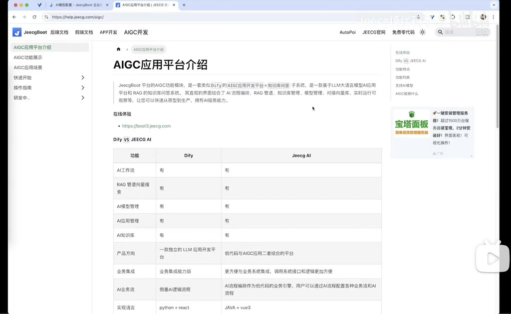
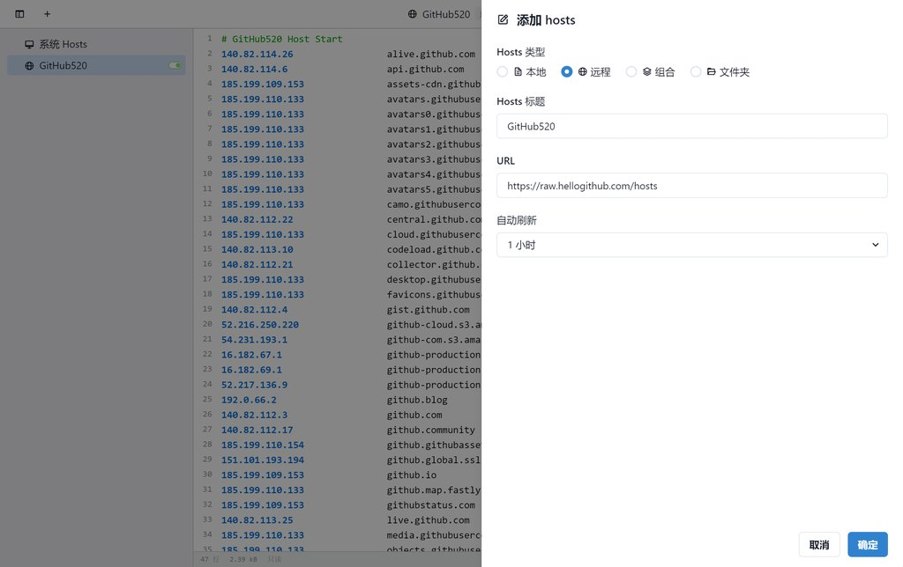
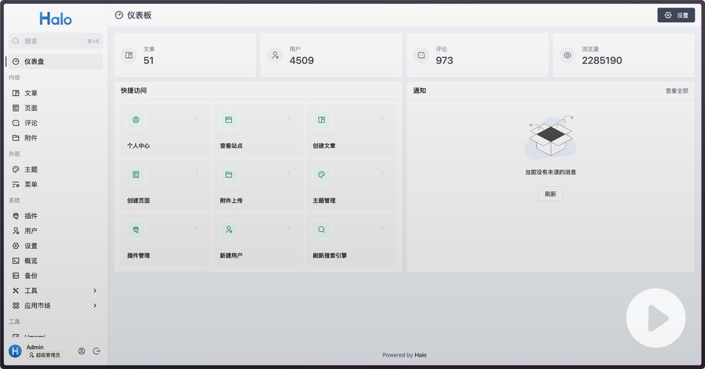
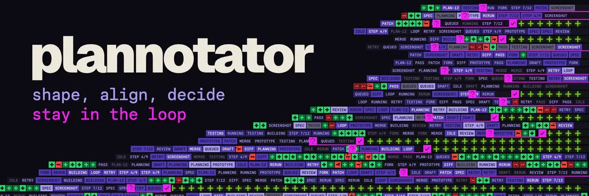
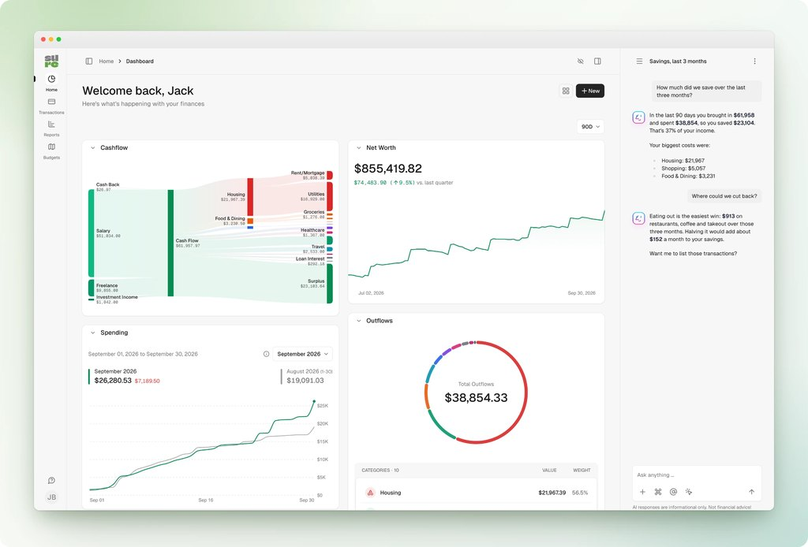
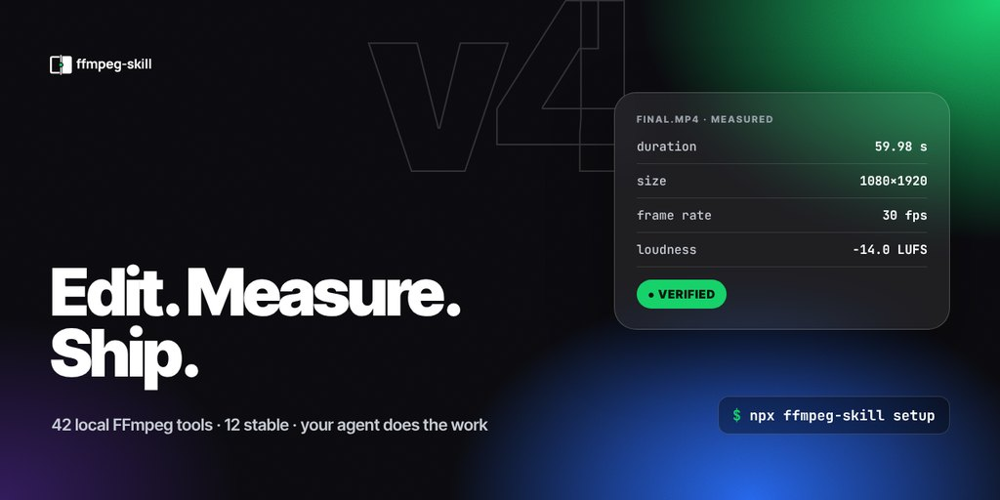

# GitHub Trending 周报 · 2026 年第 47 周（11.16 – 11.22）

> 2026 年 11 月 22 日 星期日 · 2026 年第 47 周 11.16 – 11.22 ｜ 采集时间 2026-11-22 12:43 GMT+8
> 数据来源：[中文榜](https://github.com/trending?since=weekly&spoken_language_code=zh) · [全球榜](https://github.com/trending?since=weekly)

共收录 **34** 个仓库（中文版 21，全球版 13），本周新增星标合计 **+50,085**。

## 本周 Top 5（按本周新增星标）

1. **[dream-num/univer](https://github.com/dream-num/univer)** — +7,240 · 把 Office 能力嵌进产品
2. **[GoogleChrome/modern-web-guidance-src](https://github.com/GoogleChrome/modern-web-guidance-src)** — +4,400 · 把 Web 最佳实践教给代理
3. **[mvanhorn/last30days-skill](https://github.com/mvanhorn/last30days-skill)** — +4,198 · 跨平台检索近 30 天讨论
4. **[alibaba/open-code-review](https://github.com/alibaba/open-code-review)** — +4,032 · 阿里开源的 AI 代码评审
5. **[meta/astryx](https://github.com/meta/astryx)** — +3,967 · 为人机协作准备的设计系统

---

## 一、中文版 · 21 个仓库

来源：<https://github.com/trending?since=weekly&spoken_language_code=zh>

| # | 仓库 | 语言 | 星标 | 本周 | 一句话 |
| --- | --- | --- | ---: | ---: | --- |
| 1 | [521xueweihan/HelloGitHub](https://github.com/521xueweihan/HelloGitHub) | Python | 190,428 | +1,640 | 月刊式开源项目精选 |
| 2 | [jeecgboot/JeecgBoot](https://github.com/jeecgboot/JeecgBoot) | Java | 48,572 | +112 | 一句话生成业务系统的低代码平台 |
| 3 | [fanmingming/live](https://github.com/fanmingming/live) | JavaScript | 28,929 | +107 | 电视广播台标与直播源工具 |
| 4 | [hiroi-sora/Umi-OCR](https://github.com/hiroi-sora/Umi-OCR) | Python | 48,863 | +212 | 离线批量 OCR，解压即用 |
| 5 | [ScottSloan/Bili23-Downloader](https://github.com/ScottSloan/Bili23-Downloader) | Python | 9,357 | +220 | 跨平台 B 站视频下载器 |
| 6 | [aoaostar/legado](https://github.com/aoaostar/legado) | HTML | 7,609 | +240 | 阅读 App 书源合集 |
| 7 | [maotoumao/MusicFree](https://github.com/maotoumao/MusicFree) | TypeScript | 28,770 | +239 | 插件化无广告音乐播放器 |
| 8 | [XIU2/CloudflareSpeedTest](https://github.com/XIU2/CloudflareSpeedTest) | Go | 30,124 | +178 | 优选 Cloudflare 最快 IP |
| 9 | [HIllya51/LunaTranslator](https://github.com/HIllya51/LunaTranslator) | C++ | 14,258 | +104 | 视觉小说实时翻译器 |
| 10 | [521xueweihan/GitHub520](https://github.com/521xueweihan/GitHub520) | Python | 30,350 | +61 | 一条 hosts 修好 GitHub |
| 11 | [auto-novel/auto-novel](https://github.com/auto-novel/auto-novel) | TypeScript | 1,338 | +54 | 轻小说自动机翻网站 |
| 12 | [halo-dev/halo](https://github.com/halo-dev/halo) | Java | 40,370 | +119 | 从博客到官网的建站工具 |
| 13 | [wanglin2/mind-map](https://github.com/wanglin2/mind-map) | JavaScript | 13,021 | +85 | 可自部署的 Web 思维导图 |
| 14 | [Rockyzsu/stock](https://github.com/Rockyzsu/stock) | Python | 9,124 | +89 | 30 天量化交易入门 |
| 15 | [langbot-app/LangBot](https://github.com/langbot-app/LangBot) | Python | 19,137 | +169 | 多平台 IM 机器人平台 |
| 16 | [qjfoidnh/BaiduPCS-Go](https://github.com/qjfoidnh/BaiduPCS-Go) | Go | 5,993 | +63 | 命令行版百度网盘 |
| 17 | [ruanyf/weekly](https://github.com/ruanyf/weekly) | — | 108,504 | +472 | 每周五的科技与开源见闻 |
| 18 | [timqian/chinese-independent-blogs](https://github.com/timqian/chinese-independent-blogs) | JavaScript | 24,550 | +82 | 中文独立博客清单 |
| 19 | [iDvel/rime-ice](https://github.com/iDvel/rime-ice) | Lua | 20,312 | +127 | 开箱即用的 Rime 词库 |
| 20 | [zhayujie/CowAgent](https://github.com/zhayujie/CowAgent) | Python | 48,035 | +132 | 能长期记忆的个人 AI 助理 |
| 21 | [fmz200/wool_scripts](https://github.com/fmz200/wool_scripts) | Vim Snippet | 6,024 | +53 | 代理工具配置与规则集 |

### 1. 521xueweihan / HelloGitHub

> 分享 GitHub 上有趣、入门级的开源项目。Share interesting, entry-level open source projects on GitHub.

**导读**：兴趣是最好的老师。HelloGitHub 以月刊形式分享 GitHub 上有趣、入门级的开源项目、开源书籍与实战项目，让你用很短时间感受到开源的魅力。

- 语言：Python
- 星标：190,428（本周 +1,640）
- 标签：月刊式开源项目精选
- 仓库：<https://github.com/521xueweihan/HelloGitHub>

### 2. jeecgboot / JeecgBoot

> 一款免费开源的 AI 低代码平台，也是 AI 时代构建复杂业务系统的开源基座！权限、多租户、工作流、报表、大屏、AI 知识库等通用能力开箱即用，AI 只需生成业务差异部分。AI Skills 一句话生成完整系统——建表、前后端代码、菜单权限、BPM 流程、表单、报表、大屏全自动。内置 AI 应用平台（聊天、知识库、流程编排、MCP），兼容主流大模型

**导读**：免费开源的 AI 低代码平台，内置权限、多租户、工作流、报表大屏与 AI 知识库；借助 AI Skills，一句话即可生成可运行、可维护、可二次开发的前后端业务系统。

- 语言：Java
- 星标：48,572（本周 +112）
- 标签：一句话生成业务系统的低代码平台
- 仓库：<https://github.com/jeecgboot/JeecgBoot>

### 3. fanmingming / live

> ✯ 可直连访问的电视/广播图标库与相关工具项目 ✯ 🔕 永久免费 直连访问 完整开源 不断完善的台标 支持IPv4/IPv6双栈访问 🔕

**导读**：一个可直连访问的电视与广播图标库，永久免费、完整开源，配套提供 EPG 节目单接口、M3U 订阅示例与在线播放器等工具，支持 IPv4 / IPv6 双栈访问。

- 语言：JavaScript
- 星标：28,929（本周 +107）
- 标签：电视广播台标与直播源工具
- 仓库：<https://github.com/fanmingming/live>

### 4. hiroi-sora / Umi-OCR

> OCR software, free and offline. 开源、免费的离线OCR软件。支持截屏/批量导入图片，PDF文档识别，排除水印/页眉页脚，扫描/生成二维码。内置多国语言库。

**导读**：免费、开源、可批量的离线 OCR 软件，解压即用、无需联网。支持截图识别、批量图片、PDF 文档、二维码与公式识别，并提供命令行与 HTTP 接口方便二次集成。

- 语言：Python
- 星标：48,863（本周 +212）
- 标签：离线批量 OCR，解压即用
- 仓库：<https://github.com/hiroi-sora/Umi-OCR>

### 5. ScottSloan / Bili23-Downloader

> 开源、免费、跨平台的 B 站视频下载工具，支持多线程加速、音视频分离、弹幕元数据获取、自定义命名与分类等功能。Open Source, Free, Cross-Platform Bilibili Video Downloader.

**导读**：开源、免费、跨平台的 B 站视频下载工具，支持多线程加速、音视频分离、弹幕元数据与字幕获取，可自定义命名规则与分类归档。README 明确限定仅作个人学习研究、非商业使用。

- 语言：Python
- 星标：9,357（本周 +220）
- 标签：跨平台 B 站视频下载器
- 仓库：<https://github.com/ScottSloan/Bili23-Downloader>

### 6. aoaostar / legado

> 阅读APP书源

**导读**：为「阅读」APP 维护的书源、订阅源、净化规则、排版与主题合集，每日自动同步数千条书源，并提供一键导入直链与网页版入口。

- 语言：HTML
- 星标：7,609（本周 +240）
- 标签：阅读 App 书源合集
- 仓库：<https://github.com/aoaostar/legado>

### 7. maotoumao / MusicFree

> 插件化、定制化、无广告的免费音乐播放器

**导读**：一个插件化、可定制、无广告的免费音乐播放器，目前覆盖 Android 与 HarmonyOS。音乐源以插件形式接入，界面与功能都能自行改造，不内嵌任何曲库。

- 语言：TypeScript
- 星标：28,770（本周 +239）
- 标签：插件化无广告音乐播放器
- 仓库：<https://github.com/maotoumao/MusicFree>

### 8. XIU2 / CloudflareSpeedTest

> 🌩「自选优选 IP」测试 Cloudflare CDN 延迟和速度，获取最快 IP ！当然也支持其他 CDN / 多个解析 IP 的网站 ~

**导读**：Cloudflare 公开了全部 IP 段，但其中对中国内地访客友好的并不多。这个工具批量测试延迟与速度，帮你从海量 IP 中筛出最快的那一个（IPv4 + IPv6）。

- 语言：Go
- 星标：30,124（本周 +178）
- 标签：优选 Cloudflare 最快 IP
- 仓库：<https://github.com/XIU2/CloudflareSpeedTest>

### 9. HIllya51 / LunaTranslator

> 视觉小说翻译器 / Visual Novel Translator

**导读**：面向视觉小说的翻译工具：内置文本 HOOK、OCR、剪贴板等多种取词方式，再接上在线或本地翻译引擎，让原文在游戏窗口旁实时变成中文。

- 语言：C++
- 星标：14,258（本周 +104）
- 标签：视觉小说实时翻译器
- 仓库：<https://github.com/HIllya51/LunaTranslator>

### 10. 521xueweihan / GitHub520

> 😘 让你“爱”上 GitHub，解决访问时图裂、加载慢的问题。（无需安装）

**导读**：GitHub 图片裂开、加载慢，多半是域名解析的问题。这个项目持续维护一份可用的 hosts 记录，附各平台刷新脚本与自动更新方案，不用装任何软件。

- 语言：Python
- 星标：30,350（本周 +61）
- 标签：一条 hosts 修好 GitHub
- 仓库：<https://github.com/521xueweihan/GitHub520>

### 11. auto-novel / auto-novel

> 轻小说机翻网站，支持网络小说/文库小说/本地小说

**导读**：轻小说机翻机器人：自动抓取网络小说与文库小说，调用翻译服务生成中文版本并在线阅读，也支持导入本地文件翻译，适合追更日文轻小说。

- 语言：TypeScript
- 星标：1,338（本周 +54）
- 标签：轻小说自动机翻网站
- 仓库：<https://github.com/auto-novel/auto-novel>

### 12. halo-dev / halo

> Halo 是一款强大易用的开源建站工具，从个人博客、知识库，到企业官网、在线商城，Halo 都能助您轻松实现，一站式满足您的多样化建站需求。

**导读**：强大易用的开源建站工具，从个人博客、知识库到企业官网、在线商城都能覆盖。插件与主题生态成熟，一条 Docker 命令即可拉起完整站点。

- 语言：Java
- 星标：40,370（本周 +119）
- 标签：从博客到官网的建站工具
- 仓库：<https://github.com/halo-dev/halo>

### 13. wanglin2 / mind-map

> SimpleMindMap（思绪思维导图）：一个强大的思维导图。A powerful mind map.

**导读**：中文名「思绪思维导图」。一个不依赖任何框架的 JavaScript 思维导图库，可快速开发 Web 脑图产品；同时提供支持本地文件、多主题与多格式导入导出的在线应用。

- 语言：JavaScript
- 星标：13,021（本周 +85）
- 标签：可自部署的 Web 思维导图
- 仓库：<https://github.com/wanglin2/mind-map>

### 14. Rockyzsu / stock

> 30天掌握量化交易 (持续更新)

**导读**：一份「30 天掌握量化交易」的实践项目：从行情数据获取、指标计算、策略回测到模拟实盘逐步推进，配套 A 股数据接口与可运行的示例代码。

- 语言：Python
- 星标：9,124（本周 +89）
- 标签：30 天量化交易入门
- 仓库：<https://github.com/Rockyzsu/stock>

### 15. langbot-app / LangBot

> Production-grade platform for building agentic IM bots - 生产级多平台智能机器人开发平台/ Agent、知识库编排、插件系统 / Bots for Discord / Slack / LINE / Telegram / WeChat(企业微信, 企微智能机器人, 公众号) / 飞书 / 钉钉 / QQ / Matrix e.g. Integrated with ChatGPT(GPT), DeepSeek, Dify, n8n, Langflow, Coze, Claude, Gemini, GLM, Ollama, SiliconFlow, Kimi, openclaw / hermes agent, deerflow

**导读**：生产级的多平台智能机器人开发平台，把大模型接到 QQ、微信、飞书、Discord、Telegram 等聊天平台，内置插件、知识库、工作流与 Web 管理面板。

- 语言：Python
- 星标：19,137（本周 +169）
- 标签：多平台 IM 机器人平台
- 仓库：<https://github.com/langbot-app/LangBot>

### 16. qjfoidnh / BaiduPCS-Go

> iikira/BaiduPCS-Go原版基础上集成了分享链接/秒传链接转存功能

**导读**：仿 Linux shell 命令的百度网盘命令行客户端，在原版基础上补充了分享链接与秒传链接转存，支持多线程上传下载，适合在服务器上批量搬运文件。

- 语言：Go
- 星标：5,993（本周 +63）
- 标签：命令行版百度网盘
- 仓库：<https://github.com/qjfoidnh/BaiduPCS-Go>

### 17. ruanyf / weekly

> 科技爱好者周刊，每周五发布

**导读**：阮一峰创办的科技爱好者周刊，每周五更新，记录一周内值得分享的科技动态、程序员职业观察与开源资源，另设《谁在招人》招聘帖，欢迎读者投稿。

- 语言：—
- 星标：108,504（本周 +472）
- 标签：每周五的科技与开源见闻
- 仓库：<https://github.com/ruanyf/weekly>

### 18. timqian / chinese-independent-blogs

> 中文独立博客列表

**导读**：一份仍在更新的中文独立博客列表，按主题收录个人博客与技术站点，并提供 opml 订阅。在大家都搬去公众号之后，这里是「自己域名自己排版」的那一撮人。

- 语言：JavaScript
- 星标：24,550（本周 +82）
- 标签：中文独立博客清单
- 仓库：<https://github.com/timqian/chinese-independent-blogs>

### 19. iDvel / rime-ice

> Rime 配置：雾凇拼音 | 长期维护的简体词库

**导读**：雾凇拼音：开箱即用的简体中文 Rime 配置，含全拼与双拼方案、长期维护的精校词库和详尽注释，适配小狼毫、鼠须管、Fcitx5 等几乎所有 Rime 前端。

- 语言：Lua
- 星标：20,312（本周 +127）
- 标签：开箱即用的 Rime 词库
- 仓库：<https://github.com/iDvel/rime-ice>

### 20. zhayujie / CowAgent

> Open-source personal AI assistant & Agent Harness. Plans tasks, runs tools and skills, self-evolves with memory and knowledge. Multi-agent, multi-model, multi-channel. Lightweight, extensible, one-line install.

**导读**：一个可自行部署的开源个人 AI 助理：主动规划任务、调用工具与 MCP，并通过长期记忆、知识库与自我演化逐渐了解你；支持多模型、多渠道与 7×24 常驻运行。

- 语言：Python
- 星标：48,035（本周 +132）
- 标签：能长期记忆的个人 AI 助理
- 仓库：<https://github.com/zhayujie/CowAgent>

### 21. fmz200 / wool_scripts

> 收集一些Loon、Surge、QuantumultX、ShadowRocket、Egern的配置与去广告规则。

**导读**：收集 Loon、Surge、QuantumultX、ShadowRocket、Egern 等工具的配置与去广告规则，每份配置开头都写了使用说明，可直接引用为远程规则。

- 语言：Vim Snippet
- 星标：6,024（本周 +53）
- 标签：代理工具配置与规则集
- 仓库：<https://github.com/fmz200/wool_scripts>

---

## 二、全球版 · 13 个仓库

来源：<https://github.com/trending?since=weekly>

| # | 仓库 | 语言 | 星标 | 本周 | 一句话 |
| --- | --- | --- | ---: | ---: | --- |
| 1 | [backnotprop/plannotator](https://github.com/backnotprop/plannotator) | TypeScript | 14,205 | +3,396 | 给代理产出加一层审阅 |
| 2 | [google-labs-code/stitch-skills](https://github.com/google-labs-code/stitch-skills) | TypeScript | 11,523 | +2,431 | 跨代理通用的生成式 UI 技能库 |
| 3 | [GoogleChrome/modern-web-guidance-src](https://github.com/GoogleChrome/modern-web-guidance-src) | TypeScript | 9,945 | +4,400 | 把 Web 最佳实践教给代理 |
| 4 | [alibaba/open-code-review](https://github.com/alibaba/open-code-review) | Go | 55,156 | +4,032 | 阿里开源的 AI 代码评审 |
| 5 | [mvanhorn/last30days-skill](https://github.com/mvanhorn/last30days-skill) | Python | 72,113 | +4,198 | 跨平台检索近 30 天讨论 |
| 6 | [ChromeDevTools/chrome-devtools-mcp](https://github.com/ChromeDevTools/chrome-devtools-mcp) | TypeScript | 58,717 | +2,795 | 让代理用上 Chrome DevTools |
| 7 | [tradermonty/claude-trading-skills](https://github.com/tradermonty/claude-trading-skills) | Python | 7,657 | +3,113 | 给交易员的代理技能集 |
| 8 | [ag-ui-protocol/ag-ui](https://github.com/ag-ui-protocol/ag-ui) | TypeScript | 21,051 | +3,792 | 代理与前端的通用协议 |
| 9 | [meta/astryx](https://github.com/meta/astryx) | TypeScript | 31,880 | +3,967 | 为人机协作准备的设计系统 |
| 10 | [pookjw/HermesEnabler](https://github.com/pookjw/HermesEnabler) | Objective-C | 2,361 | +524 | 给任意手表装爱马仕表盘 |
| 11 | [we-promise/sure](https://github.com/we-promise/sure) | Ruby | 17,183 | +2,041 | 自托管的个人财务面板 |
| 12 | [dream-num/univer](https://github.com/dream-num/univer) | TypeScript | 31,117 | +7,240 | 把 Office 能力嵌进产品 |
| 13 | [kajisho5/ffmpeg-skill](https://github.com/kajisho5/ffmpeg-skill) | Python | 9,347 | +3,598 | 代理本地剪片并自检 |

### 1. backnotprop / plannotator

> The workspace to stay in the loop and on top of agents - shape, decide, plan, annotate, review code, share with team, and send all feedback to agents with one click.

**导读**：编码代理的「审阅层」：Claude Code、Codex、Copilot CLI、Gemini CLI 等产出计划、原型与变体后，在本地浏览器里逐条批注、取舍、放行，让人始终留在回路里。

- 语言：TypeScript
- 星标：14,205（本周 +3,396）
- 标签：给代理产出加一层审阅
- 仓库：<https://github.com/backnotprop/plannotator>

### 2. google-labs-code / stitch-skills

> A library of Agent Skills designed to work with the Stitch MCP server. Each skill follows the Agent Skills open standard, for compatibility with coding agents such as Antigravity, Gemini CLI, Claude Code, Cursor.

**导读**：配合 Stitch MCP Server 使用的 Agent Skills 库，每个技能都遵循 Agent Skills 开放标准，因此可在 Antigravity、Gemini CLI、Claude Code、Cursor 等编码代理间通用。

- 语言：TypeScript
- 星标：11,523（本周 +2,431）
- 标签：跨代理通用的生成式 UI 技能库
- 仓库：<https://github.com/google-labs-code/stitch-skills>

### 3. GoogleChrome / modern-web-guidance-src

> Keep your coding agent up to date with the latest web best practices

**导读**：Modern Web Guidance 的源仓库，把 Web 平台能力、最佳实践与浏览器兼容数据做成代理技能，让编码助手不再照抄过期写法，而是用上现代 API。

- 语言：TypeScript
- 星标：9,945（本周 +4,400）
- 标签：把 Web 最佳实践教给代理
- 仓库：<https://github.com/GoogleChrome/modern-web-guidance-src>

### 4. alibaba / open-code-review

> Secure, fast, efficient, battle-tested at Alibaba's scale. Hybrid architecture code review tool: deterministic pipelines + LLM Agent, precise line-level comments, built-in multi-language ruleset (NPE, thread-safety, XSS, SQL injection), OpenAI & Anthropic compatible.

**导读**：阿里内部打磨两年的 AI 代码评审 CLI：服务过数万开发者、识别出数百万缺陷后开源。配置一个模型端点即可接入现有评审流程，按仓库规范给出意见。

- 语言：Go
- 星标：55,156（本周 +4,032）
- 标签：阿里开源的 AI 代码评审
- 仓库：<https://github.com/alibaba/open-code-review>

### 5. mvanhorn / last30days-skill

> AI agent skill that researches any topic across Reddit, X, YouTube, HN, Polymarket, and the web - then synthesizes a grounded summary

**导读**：一个研究型 Agent 技能：给定任意话题，自动在 Reddit、X、YouTube、Hacker News、Polymarket 与公开网页上检索近 30 天的讨论，再汇总成有出处的结论。

- 语言：Python
- 星标：72,113（本周 +4,198）
- 标签：跨平台检索近 30 天讨论
- 仓库：<https://github.com/mvanhorn/last30days-skill>

### 6. ChromeDevTools / chrome-devtools-mcp

> Chrome DevTools for coding agents

**导读**：以 MCP Server 和 CLI 两种形式，把 Chrome DevTools 交给编码代理：控制并检查真实浏览器，做可靠自动化、深度调试与性能分析，而不是盲写代码。

- 语言：TypeScript
- 星标：58,717（本周 +2,795）
- 标签：让代理用上 Chrome DevTools
- 仓库：<https://github.com/ChromeDevTools/chrome-devtools-mcp>

### 7. tradermonty / claude-trading-skills

> Claude Code skills for equity investors and traders — market analysis, technical charting, economic calendars, screeners, and trading strategy development.

**导读**：面向股票投资者与交易员的 Claude Code 技能集，把行情分析、财报解读、交易计划与盘后复盘拆成可复用技能，让代理按固定流程处理投研工作。

- 语言：Python
- 星标：7,657（本周 +3,113）
- 标签：给交易员的代理技能集
- 仓库：<https://github.com/tradermonty/claude-trading-skills>

### 8. ag-ui-protocol / ag-ui

> AG-UI: the Agent-User Interaction Protocol. Bring Agents into Frontend Applications.

**导读**：开放的轻量事件协议，标准化「代理 ↔ 用户界面」之间的连接：状态同步、流式输出、工具调用与人机协同都走同一套事件，前端不必为每个代理重写适配。

- 语言：TypeScript
- 星标：21,051（本周 +3,792）
- 标签：代理与前端的通用协议
- 仓库：<https://github.com/ag-ui-protocol/ag-ui>

### 9. meta / astryx

> An open source design system that's fully customizable and agent ready

**导读**：Meta 开源的设计系统，基于 React 19 与 StyleX，面向「人与代理一起写界面」的工作方式：组件与主题可整体定制，代理改样式也不会撞坏设计规范。目前为 Beta。

- 语言：TypeScript
- 星标：31,880（本周 +3,967）
- 标签：为人机协作准备的设计系统
- 仓库：<https://github.com/meta/astryx>

### 10. pookjw / HermesEnabler

> Enable Hermès Watch Faces on any Apple Watch devices

**导读**：让任意 Apple Watch 用上爱马仕表盘：在 macOS 上侧载预编译 IPA，或直接用 Xcode 构建安装。需要 iPhone 与手表配对，且 watchOS 版本在支持范围内。

- 语言：Objective-C
- 星标：2,361（本周 +524）
- 标签：给任意手表装爱马仕表盘
- 仓库：<https://github.com/pookjw/HermesEnabler>

### 11. we-promise / sure

> The personal finance app for everyone (by everyone)

**导读**：个人财务应用：账户、交易、预算与净资产在一屏内看清，支持自托管、数据留在自己手里。它接续了已归档的 Maybe Finance，继续走开源路线。

- 语言：Ruby
- 星标：17,183（本周 +2,041）
- 标签：自托管的个人财务面板
- 仓库：<https://github.com/we-promise/sure>

### 12. dream-num / univer

> Build your own AI office with Univer Office SDK. Bring editing, calculation, collaboration, and file processing into your product for people and AI agents. Built on an extensible open-source core.

**导读**：可嵌入自家产品的 Office SDK：表格、文档、演示、关系表、画布与 PDF 的编辑、计算、协同与文件处理，人和代理共用同一套数据与权限。

- 语言：TypeScript
- 星标：31,117（本周 +7,240）
- 标签：把 Office 能力嵌进产品
- 仓库：<https://github.com/dream-num/univer>

### 13. kajisho5 / ffmpeg-skill

> Local video editor for coding agents: 42 FFmpeg tools with a machine-readable contract and an MCP server, for Claude Code, Cursor and Codex. Cut, captions, reframe, loudness, platform exports. No cloud, no API keys.

**导读**：面向编码代理的本地视频剪辑技能：42 个 FFmpeg 工具覆盖剪切、字幕、转码，剪完自动生成带检查项与时间线的审阅页，全过程不上云、不需要 API Key。

- 语言：Python
- 星标：9,347（本周 +3,598）
- 标签：代理本地剪片并自检
- 仓库：<https://github.com/kajisho5/ffmpeg-skill>

---

## 说明

- 榜单顺序与字段取自 GitHub Trending 每周榜（since=weekly），星标数与「本周新增」为采集时刻页面展示值。
- 「简介」为仓库在 GitHub 上的原始描述；「导读」为基于 README 的整理与中文编译，非逐字翻译。
- 配图取自仓库 README，已等比缩放并转存为 jpg（最长边 ≤ 1024px、单张 < 1MB）；文中路径相对于项目根目录，版权归原作者所有。
- 网页版：打开 `index.html`，右上角切换「日报 / 周报」与日期。
- 本文档由 `tools/build-report.js` 于 2026/11/22 12:46:54 生成。
